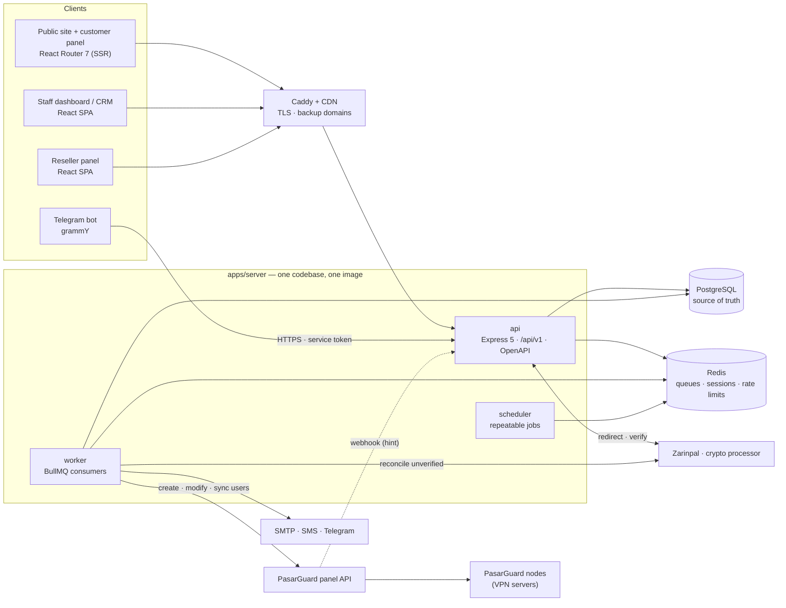
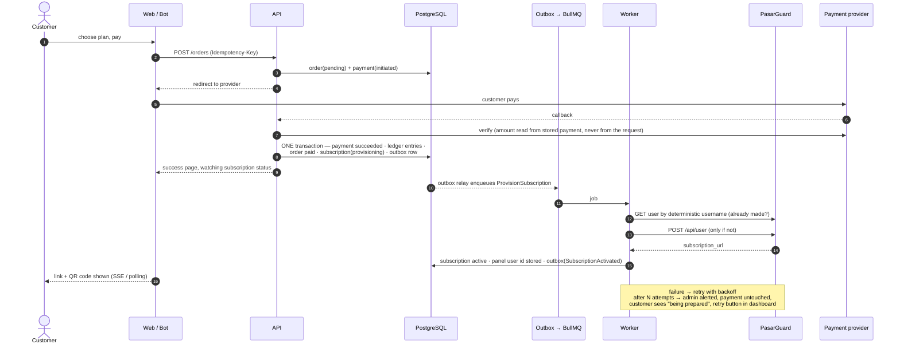
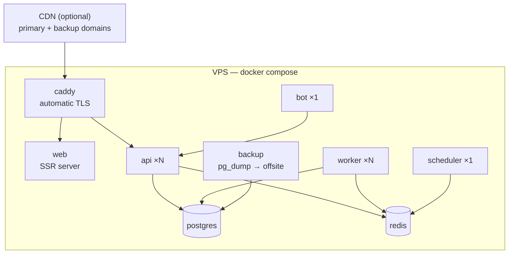

# مرحله‌ی ۱: تحلیل و معماری

> وضعیت: **تأییدشده.** این سند معماری و انتخاب تکنولوژی را مشخص می‌کند. طراحی دیتابیس در [مرحله‌ی ۲](02-database.md) است.

## خلاصه‌ی تصمیم‌ها

| موضوع | تصمیم | دلیل اصلی |
|---|---|---|
| مسیر کد | توسعه‌ی کد فعلی (تصمیم شما) | احراز هویت، پرداخت، CRM، داشبورد و تست‌ها دوباره استفاده می‌شوند |
| سبک معماری | **مونولیت ماژولار** با چند نقش اجرایی (`api`، `worker`، `scheduler`، `bot`) | تراکنش مالی و تحویل سرویس باید در یک دیتابیس و یک تراکنش باشند؛ میکروسرویس برای این اندازه فقط هزینه اضافه می‌کند |
| زبان بک‌اند | **TypeScript** (مهاجرت تدریجی از JavaScript فعلی) | لایه‌ی داده به‌هرحال بازنویسی می‌شود؛ منطق مالی بدون type خطرناک است |
| دیتابیس | **PostgreSQL** (تصمیم شما) + ORM **Drizzle** | ACID، constraint، قفل سطر (`FOR UPDATE`) برای کیف پول و پورسانت |
| صف و کش | **Redis + BullMQ** | تلاش مجدد با backoff، کارهای تکرارشونده، صف‌های جدا با اولویت |
| تضمین تحویل | **Transactional Outbox** | حتی اگر Redis لحظه‌ای در دسترس نباشد، کار ساخت سرویس گم نمی‌شود |
| قرارداد API | **zod** در یک پکیج مشترک + تولید خودکار **OpenAPI** | یک منبع واحد برای اعتبارسنجی سرور، فرم‌های سایت، ربات و مستندات |
| فرانت‌اند | React 19 فعلی + ارتقای **React Router 7 به framework mode** | SSR برای سئو در صفحات عمومی، بدون بازنویسی کامپوننت‌ها |
| ربات تلگرام | **grammY**، به‌عنوان کلاینت همان API | «همان منطق و دیتابیس سایت، نه سیستم جدا» — با یک نقطه‌ی اعمال مجوز |
| پنل VPN | **PasarGuard** (تصمیم شما) پشت یک رابط `PanelDriver` | پنل‌های دیگر بعداً بدون تغییر هسته اضافه می‌شوند |
| پرداخت | زرین‌پال + کارت‌به‌کارت + ارز دیجیتال (تصمیم شما) پشت رابط `PaymentProvider` | وابسته نبودن به یک درگاه |
| استقرار | **Docker Compose** + **Caddy** | TLS خودکار برای چند دامنه‌ی پشتیبان |

---

## ۱. نقطه‌ی شروع: چه داریم و با آن چه می‌کنیم

کد فعلی یک پایه‌ی سالم دارد. مهم‌تر از آن، **داده‌ی واقعی تقریباً وجود ندارد**: بررسی قبلی نشان داد هیچ فروش واقعی ثبت نشده. پس مهاجرت از MongoDB به PostgreSQL بیشتر بازنویسی لایه‌ی داده است تا انتقال داده، و ریسک آن پایین است.

| بخش فعلی | سرنوشت |
|---|---|
| ساختار component-per-domain (routes / service / model) | **حفظ می‌شود** و به ساختار ماژول کامل‌تری تبدیل می‌شود (بخش ۵) |
| سرویس‌ها، قوانین کسب‌وکار، error handling مرکزی، pino | **حفظ می‌شوند**؛ فقط به TypeScript منتقل می‌شوند |
| مدل‌های Mongoose و `connect-mongo` | **جایگزین می‌شوند** با Drizzle/PostgreSQL و session روی Redis |
| `express-validator` | **به‌تدریج جایگزین می‌شود** با zod مشترک |
| آداپتر زرین‌پال و درگاه جعلی برای تست | **حفظ می‌شوند** و پشت رابط `PaymentProvider` قرار می‌گیرند |
| ~۲۶۰ تست بک‌اند (node:test) و ~۱۰۰ تست فرانت (vitest) | **حفظ می‌شوند**؛ تست‌های لایه‌ی HTTP تقریباً بدون تغییر روی دیتابیس جدید اجرا می‌شوند، چون از بیرون تست می‌کنند |
| داشبورد، سایدبار، CRM، تحلیل فروش، ژورنال | **حفظ می‌شوند** و گسترش می‌یابند |
| قانون لایه‌بندی فرانت (`import/no-restricted-paths`) | **به بک‌اند هم تعمیم می‌یابد** تا مرز ماژول‌ها قابل اعمال باشد، نه فقط توافقی |

**یک پیش‌نیاز فوری:** پروژه هنوز زیر git نیست. قبل از شروع بازسازی باید مخزن git ساخته شود؛ تغییری در این اندازه بدون تاریخچه قابل بازگشت نیست.

---

## ۲. سبک معماری: مونولیت ماژولار با چند نقش اجرایی

یک کدبیس، یک ایمیج Docker، چند نقطه‌ی ورود:

| نقش | کار | مقیاس‌پذیری |
|---|---|---|
| `api` | همه‌ی درخواست‌های HTTP: سایت، پنل کاربر، داشبورد، پنل نماینده، ربات، webhook‌ها | افقی (چند نسخه پشت Caddy) |
| `worker` | مصرف صف‌ها: ساخت سرویس، اعلان‌ها، همگام‌سازی مصرف، تأیید پرداخت‌های معوق | افقی (تعداد worker مستقل از api) |
| `scheduler` | زمان‌بندی کارهای تکرارشونده (فقط job می‌سازد، خودش کاری انجام نمی‌دهد) | یک نسخه |
| `bot` | ربات تلگرام؛ فقط از طریق API کار می‌کند | یک نسخه، قابل اجرا روی سرور جدا |

**چرا میکروسرویس نه؟** قلب سیستم این زنجیره است: «پرداخت موفق → ثبت در دفتر مالی → فعال‌سازی سفارش → ایجاد اشتراک». این چهار کار باید با هم اتفاق بیفتند یا هیچ‌کدام. در یک دیتابیس این یک تراکنش است. بین سرویس‌های جدا، به saga و جبران خطا نیاز دارد، آن هم برای تیمی کوچک و بدون نیاز واقعی به مقیاس مستقل. مرز ماژول‌ها طوری کشیده می‌شود که اگر روزی لازم شد، جدا کردن یک ماژول ممکن باشد.

---

## ۳. انتخاب تکنولوژی‌ها و دلیل هر کدام

### بک‌اند
- **Node.js 24 + Express 5** — از کد فعلی. تیم با آن آشناست و برای این بار کافی است.
- **TypeScript** — مهاجرت تدریجی (`allowJs`)، از ماژول‌هایی که روی PostgreSQL بازنویسی می‌شوند شروع می‌شود. در منطقی که با پول، حجم و تاریخ انقضا کار می‌کند، اشتباه نوع داده به ضرر مالی تبدیل می‌شود.
- **Drizzle ORM** — schema در TypeScript، کوئری‌ها شبیه SQL و شفاف، پشتیبانی از `SELECT … FOR UPDATE` برای قفل کیف پول، و migration تولیدشده. Prisma برای قفل سطر به SQL خام نیاز دارد و در منطق مالی همان‌جایی که بیشتر لازم است کم می‌آورد.
- **zod + OpenAPI** — schemaها در پکیج مشترک `contracts` تعریف می‌شوند. سرور با آن‌ها اعتبارسنجی می‌کند، فرانت و ربات همان‌ها را import می‌کنند، و مستند OpenAPI از همان‌ها تولید می‌شود. الان در کد کامنت‌هایی هست مثل «این schema باید با validator سرور یکی بماند» — یعنی دو نسخه که دستی هماهنگ نگه داشته می‌شوند. این تصمیم آن مشکل را از ریشه حل می‌کند.

### داده و زیرساخت
- **PostgreSQL 16+** — منبع حقیقت برای همه‌چیز جز مصرف لحظه‌ای ترافیک، که منبع حقیقتش پنل VPN است.
- **Redis 7** — صف‌ها (BullMQ)، session‌ها (به‌جای `connect-mongo`)، شمارنده‌های rate limit (تا چند نسخه‌ی api یک محدودیت مشترک داشته باشند)، و کش کوتاه‌مدت.
- **BullMQ** — تلاش مجدد با backoff نمایی، job تکرارشونده، محدودیت هم‌زمانی برای هر صف (مثلاً محدود کردن تعداد درخواست هم‌زمان به PasarGuard)، و داشبورد بررسی صف برای مدیر.

### فرانت‌اند
- **React 19 + Tailwind v4 + shadcn + RTK Query** — از کد فعلی.
- **React Router 7 framework mode** — همین حالا روتر پروژه React Router 7 است، ولی در حالت کتابخانه‌ای. حالت framework رندر سمت سرور را روی همان کامپوننت‌ها ممکن می‌کند. صفحات عمومی (خانه، قیمت‌ها، وبلاگ، آموزش‌ها، صفحات فرود) با SSR رندر می‌شوند تا متاتگ‌ها، داده‌ی ساختاریافته و محتوا برای موتور جست‌وجو قابل خواندن باشد. پنل‌ها (کاربر، نماینده، داشبورد) مثل الان سمت کلاینت می‌مانند. جایگزین آن، Next.js در کنار SPA فعلی، یعنی نگهداری دو کدبیس فرانت با کامپوننت‌های تکراری.
- **i18next** برای چندزبانی؛ **راست‌چین** با ویژگی `dir` و کلاس‌های منطقی Tailwind (`ms-*`، `pe-*`، `start-*`). کلاس‌هایی مثل `ml-*` و `mr-*` که الان در کد هستند در RTL برعکس می‌شوند و باید جایگزین شوند.

### ربات
- **grammY** — فریم‌ورک TypeScript برای ربات تلگرام با پشتیبانی از گفت‌وگوهای چندمرحله‌ای (برای خرید و ثبت تیکت).
- ربات **به دیتابیس وصل نمی‌شود**. کاربر تلگرام به حساب سایت متصل می‌شود و ربات از طرف او، با توکن سرویس، API را صدا می‌زند. به این ترتیب مجوز، rate limit، audit log و قوانین کسب‌وکار فقط یک جا اعمال می‌شوند. این همان «API داخلی که سایت، ربات و پنل نماینده همگی از آن استفاده کنند» است که در نیازمندی‌ها آمده.

---

## ۴. نمودار اجزای سیستم



---

## ۵. ماژول‌های دامنه و مرزهایشان

هر ماژول ساختار یکسان دارد: `routes` (HTTP) ← `service` (قوانین) ← `repository` (Drizzle)، به‌علاوه‌ی `schema` (zod)، `events` و `jobs`. هر ماژول فقط از طریق service عمومی ماژول دیگر با آن کار می‌کند، نه با جدول‌هایش. این قانون با ESLint اعمال می‌شود، مثل قانون فعلی فرانت.

| ماژول | مسئولیت | وضعیت فعلی |
|---|---|---|
| `identity` | ثبت‌نام، ورود، OTP ایمیل/پیامک، session، ورود دومرحله‌ای، اتصال حساب تلگرام | بخشی موجود (`auth`، `users`) |
| `access` | نقش‌ها و مجوزهای قابل تنظیم، audit log | بخشی موجود (۴ نقش ثابت) |
| `catalog` | پلن‌ها: حجمی، زمانی، ترکیبی، نامحدود، محدودیت دستگاه | بخشی موجود (`products`) |
| `billing` | سفارش، فاکتور، پرداخت، کد تخفیف، `PaymentProvider`ها | بخشی موجود (`orders`) |
| `wallet` | دفتر مالی دوطرفه، کیف پول، بازپرداخت | جدید |
| `subscriptions` | چرخه‌ی عمر سرویس: ساخت، تمدید، ارتقا، ریست، تعلیق، تست رایگان، تمدید خودکار | جدید |
| `provisioning` | `PanelDriver`ها، همگام‌سازی مصرف، proxy لینک اشتراک | جدید |
| `infrastructure` | سرورها، لوکیشن‌ها، ظرفیت، مانیتورینگ، جابه‌جایی گروهی | جدید |
| `partners` | نماینده‌ها (چندسطحی اختیاری)، معرفی، افیلیت، پورسانت | جدید |
| `notifications` | کانال‌ها (ایمیل/پیامک/تلگرام)، قالب‌های قابل ویرایش، کمپین، پیام گروهی | بخشی موجود (mailer) |
| `support` | تیکت، دسته، اولویت، ارجاع، پاسخ آماده | جدید |
| `crm` | پروفایل مشتری، برچسب، سگمنت، یادداشت، خروجی CSV | موجود |
| `analytics` | MRR، churn، LTV، نرخ تبدیل و تمدید، سود هر سرور | بخشی موجود |
| `content` | وبلاگ، آموزش‌ها، FAQ، صفحات قانونی، صفحات فرود، سئو | بخشی موجود (`posts`) |

**ارتباط بین ماژول‌ها** دو شکل دارد:
- **هم‌زمان:** صدا زدن service عمومی ماژول دیگر، داخل همان تراکنش. مثال: `billing` هنگام موفقیت پرداخت، `wallet` را برای ثبت در دفتر صدا می‌زند.
- **ناهم‌زمان:** رویداد دامنه (مثلاً `SubscriptionActivated`) که در جدول outbox نوشته می‌شود و ماژول‌های دیگر (`notifications`، `partners` برای پورسانت، `analytics`) آن را از صف مصرف می‌کنند.

---

## ۶. جریان حیاتی: پرداخت ← تحویل سرویس

مهم‌ترین اصل پروژه این است: **سرویس بعد از پرداخت، بدون دخالت انسان و در چند ثانیه تحویل شود، و اگر نشد، پول گم نشود و مدیر خبردار شود.**



تضمین‌هایی که این طراحی می‌دهد:

1. **پرداخت هرگز بدون ثبت نمی‌ماند.** موفقیت پرداخت، ثبت در دفتر مالی، و «نیاز به ساخت سرویس» در یک تراکنش ثبت می‌شوند. اگر سرور وسط کار از کار بیفتد، یا همه ثبت شده‌اند یا هیچ‌کدام، و درگاه دوباره قابل استعلام است.
2. **کار ساخت سرویس گم نمی‌شود.** job مستقیم در Redis گذاشته نمی‌شود. اول در جدول outbox داخل همان تراکنش نوشته می‌شود و یک relay آن را به صف منتقل می‌کند. قطعی لحظه‌ای Redis فقط تحویل را چند ثانیه عقب می‌اندازد.
3. **تلاش مجدد، سرویس تکراری نمی‌سازد.** نام کاربری روی پنل از شناسه‌ی اشتراک ساخته می‌شود (قطعی، نه تصادفی). worker قبل از ساختن بررسی می‌کند که کاربر وجود دارد یا نه. پس اگر درخواست قبلی به پنل رسیده ولی پاسخش گم شده، تلاش بعدی همان کاربر را پیدا می‌کند.
4. **پرداخت تکراری دو سرویس نمی‌سازد.** هر پرداخت یک `(provider, provider_reference)` یکتا دارد و endpointهای ایجاد سفارش `Idempotency-Key` می‌پذیرند.
5. **شکست دیده می‌شود.** بعد از چند تلاش ناموفق (مثلاً حدود یک دقیقه) به مدیر در تلگرام هشدار داده می‌شود. worker در پس‌زمینه ادامه می‌دهد. مشتری وضعیت «در حال آماده‌سازی» می‌بیند، نه خطا، و مدیر در داشبورد دکمه‌ی «تلاش دوباره» دارد.
6. **کاربری که صفحه را بست هم سرویسش را می‌گیرد.** اگر مشتری بعد از پرداخت صفحه را ببندد و callback درگاه هرگز به ما نرسد، یک job دوره‌ای پرداخت‌های تأییدنشده را از درگاه استعلام می‌کند و همین مسیر را ادامه می‌دهد.

همین مسیر برای تمدید، ارتقا، خرید از کیف پول، خرید نماینده و تأیید دستی کارت‌به‌کارت هم استفاده می‌شود. فقط نقطه‌ی شروع فرق دارد.

---

## ۷. یکپارچه‌سازی با PasarGuard

API پنل را از کد منبع آن بررسی کردم. آنچه برای طراحی مهم است:

| نیاز ما | در PasarGuard |
|---|---|
| احراز هویت | `POST /api/admin/token` (فرم OAuth2) یا API key با مجوزهای جدا برای هر عملیات |
| ساخت / خواندن / ویرایش / حذف کاربر | `POST /api/user` و `GET` / `PUT` / `DELETE /api/user/by-id/{id}` یا `by-username` |
| حجم و انقضا | `data_limit` (بایت، ۰ = نامحدود)، `expire`، `data_limit_reset_strategy` |
| محدودیت دستگاه | `hwid_limit` — پاسخ مستقیم به «محدودیت تعداد دستگاه» |
| شروع اشتراک از اولین اتصال | وضعیت `on_hold` با `on_hold_expire_duration` |
| ریست حجم / ابطال لینک | `POST …/reset` و `POST …/revoke_sub` |
| تمدید از پیش خریداری‌شده | `next_plan` و `POST …/active_next` |
| وضعیت و مصرف | `status` (active، disabled، on_hold، limited، expired)، `used_traffic`، `online_at`، `subscription_url` |
| عملیات گروهی | `/api/users/bulk/*` برای تمدید، تغییر حجم و غیرفعال‌سازی گروهی |
| اعلان | webhook با آستانه‌های روز مانده و درصد مصرف |

تصمیم‌های طراحی:

- **رابط `PanelDriver`** با عملیات مستقل از پنل: `createUser`، `getUser`، `updateLimits`، `resetUsage`، `revokeSubscription`، `setEnabled`، `deleteUser`، `listUsers` (برای همگام‌سازی)، `health`. `PasarGuardDriver` اولین پیاده‌سازی است. Marzban، 3x-ui و Hiddify بعداً فقط یک driver جدید هستند.
- **هر سرور/پنل یک رکورد** در `infrastructure` است، با آدرس، credential رمزنگاری‌شده، ظرفیت و اولویت. سیستم از روز اول با چند نمونه‌ی پنل کار می‌کند.
- **احراز هویت با API key.** از توکن ادمین و رمز عبور استفاده نمی‌شود، چون با API key می‌شود فقط مجوزهای لازم را داد و در صورت نشت، آن را باطل کرد.
- **مصرف: پنل منبع حقیقت است، CRM کپی نگه می‌دارد.** همگام‌سازی سه لایه دارد:
  1. webhook پنل به‌عنوان **اشاره**: فقط باعث همگام‌سازی فوری همان کاربر می‌شود.
  2. **همگام‌سازی دوره‌ای کامل** (مثلاً هر ۵ دقیقه) به‌عنوان منبع اطمینان. خود PasarGuard در تغییرات اخیرش اشاره کرده که webhook‌های ناموفق قبلاً دوباره ارسال نمی‌شدند؛ پس به webhook به‌تنهایی اعتماد نمی‌شود.
  3. **بازخوانی لحظه‌ای** وقتی کاربر پنلش را باز می‌کند، با کش کوتاه.
- **آستانه‌ها (۸۰٪، ۱۰۰٪، ۳ روز و ۱ روز مانده) را CRM تشخیص می‌دهد، نه پنل.** قالب پیام‌ها، کانال‌ها و منطق «هر اعلان فقط یک بار» باید در CRM قابل مدیریت باشد.
- **پراکسی لینک اشتراک (پیشنهادی، در مرحله‌ی ۴ با تست قطعی می‌شود).** لینکی که به مشتری داده می‌شود روی دامنه‌ی خود ما است (`/s/{token}`) و سرور آن را به `subscription_url` پنل پراکسی می‌کند، همراه با هدرهایی که کلاینت‌ها برای نمایش حجم و تاریخ انقضا می‌خوانند. فایده‌ها: آدرس پنل پنهان می‌ماند، پنل یا سرور را می‌شود جابه‌جا کرد بدون اینکه لینک مشتری عوض شود، و لینک از پشت CDN و دامنه‌های پشتیبان سرو می‌شود.
- **یک محدودیت شناخته‌شده در خود PasarGuard:** طبق issue شماره‌ی ۹۲ مخزن node، کاربری که منقضی یا غیرفعال می‌شود ممکن است اتصال باز فعلی‌اش را تا قطع شدن نگه دارد. این روی «قطع فوری» اثر دارد و در تست MVP بررسی می‌شود.
- **مجوز:** PasarGuard تحت AGPL-3.0 است. ما فقط از طریق API با آن کار می‌کنیم و کدش را تغییر نمی‌دهیم یا توزیع نمی‌کنیم. در این حالت الزامات AGPL به کد ما سرایت نمی‌کند. اگر روزی قرار شد خود پنل تغییر کند، باید دوباره بررسی شود.

---

## ۸. پرداخت‌ها

رابط `PaymentProvider`: `initiate` (شروع پرداخت و آدرس هدایت)، `verify` (تأیید)، `reconcile` (استعلام پرداخت‌های معلق). هر پرداخت یک ماشین حالت دارد: `initiated → pending → succeeded | failed | expired | refunded`.

| روش | جریان | نکته‌ی طراحی |
|---|---|---|
| **زرین‌پال** | هدایت ← callback ← verify | مبلغ verify همیشه از پرداخت ذخیره‌شده خوانده می‌شود، نه از درخواست. پرداخت‌های تأییدنشده به‌صورت دوره‌ای استعلام می‌شوند. |
| **کارت‌به‌کارت** | مشتری رسید و شماره‌ی پیگیری را آپلود می‌کند ← `pending_review` ← حسابدار تأیید یا رد می‌کند | علامت‌گذاری خودکار موارد مشکوک: تصویر رسید تکراری (hash)، شماره‌ی پیگیری تکراری، مبلغ نامطابق. تأیید «نیمه‌خودکار» (تطبیق با پیامک بانک) به فاز بعد می‌رود. |
| **NOWPayments** | هدایت به فاکتور NOWPayments ← callback امضاشده ← خواندن دوباره‌ی وضعیت از API | callback فقط اشاره است؛ وضعیت قبل از ثبت از API خودشان دوباره خوانده می‌شود. |
| **USDT مستقیم روی TRON** | نمایش آدرس کیف پول و مبلغ دقیق ← worker انتقال‌های ورودی را از بلاک‌چین می‌خواند ← جور کردن با فاکتور بر اساس مبلغ دقیق | جزئیات در [مرحله‌ی ۲](02-database.md). انتقال‌های جورنشده در صف بررسی کارمند می‌مانند. |

برای هر دو روش ارز دیجیتال، نرخ تبدیل لحظه‌ی صدور فاکتور ثبت و قفل می‌شود و فاکتور زمان انقضا دارد.

**پول:** همیشه عدد صحیح در کوچک‌ترین واحد ذخیره می‌شود، هرگز اعشاری. **کیف پول و پورسانت روی دفتر دوطرفه** ساخته می‌شوند: هر جابه‌جایی مالی چند ردیف متوازن است و موجودی کیف پول از جمع ردیف‌ها قابل بازسازی است. موجودی کش‌شده داخل همان تراکنش و با قفل سطر به‌روز می‌شود تا دو خرید هم‌زمان نتوانند یک موجودی را دو بار خرج کنند.

---

## ۹. صف‌ها و کارهای زمان‌بندی‌شده

| صف / کار | محرک | رفتار در شکست |
|---|---|---|
| `provisioning` | outbox بعد از پرداخت، تمدید، ارتقا | backoff نمایی. تلاش‌های اول سریع (ثانیه‌ای) چون مشتری منتظر است. بعد از حدود یک دقیقه هشدار به مدیر و ادامه در پس‌زمینه. |
| `notifications` | رویدادهای دامنه، کمپین‌ها | چند تلاش. شکست نهایی ثبت می‌شود و در پروفایل مشتری دیده می‌شود. |
| `usage-sync` | هر ۵ دقیقه + webhook پنل + بازخوانی دستی | ادامه از صفحه‌ی بعدی؛ شکست یک پنل بقیه را متوقف نمی‌کند. |
| `server-health` | هر دقیقه | بعد از چند شکست پشت سر هم، هشدار به مدیر و خارج شدن سرور از چرخه‌ی تخصیص کاربر جدید. |
| `payment-reconcile` | هر چند دقیقه | پرداخت‌های معلق زرین‌پال و NOWPayments. |
| `exchange-rate` | هر دقیقه | خواندن نرخ USDT از نوبیتکس. اگر چند دقیقه نرسد، پرداخت ارز دیجیتال خودکار متوقف می‌شود تا با نرخ کهنه فروخته نشود. |
| `usdt-watch` | هر ۳۰ ثانیه | خواندن انتقال‌های ورودی کیف پول TRON از آخرین بلاک دیده‌شده؛ قطعی موقت API بلاک‌چین فقط تأخیر می‌آورد، چون ادامه از همان بلاک است. |
| `renewals` | ساعتی | تمدید خودکار از کیف پول قبل از انقضا؛ اگر موجودی کافی نباشد، اعلان. |
| `reminders` | ساعتی | یادآوری انقضا و مصرف، هر آستانه فقط یک بار. |
| `campaigns` | زمان‌بندی مدیر | ارسال گروهی با محدودیت نرخ برای هر کانال. |
| پشتیبان‌گیری | cron در کانتینر جدا | شکست پشتیبان‌گیری هشدار دارد، نه سکوت. |

---

## ۱۰. امنیت

| نیازمندی | پاسخ معماری |
|---|---|
| نقش‌ها و مجوزهای قابل تنظیم | جدول نقش و مجوز (مثلاً `subscriptions:update`، `payments:approve`) به‌جای ۴ نقش ثابت فعلی. نقش‌های پیش‌فرض: مدیر کل، پشتیبان، حسابدار، ویراستار محتوا. نماینده یک نوع حساب جدا است، نه فقط یک نقش. |
| ورود دومرحله‌ای | TOTP، **اجباری برای کارمندان**، اختیاری برای مشتری، با کدهای پشتیبان. |
| Audit log | جدول append-only: چه کسی، چه کاری، روی چه چیزی، قبل و بعد، IP. هر عملیات کارمند روی سرویس، پول یا نقش ثبت می‌شود. |
| Rate limiting و brute force | شمارنده‌های مشترک در Redis. محدودیت جدا برای ورود، OTP، ثبت تیکت و API نماینده. قفل موقت حساب بعد از تلاش‌های مکرر. |
| SQL injection | کوئری پارامتری Drizzle؛ SQL رشته‌ای ساخته نمی‌شود. |
| XSS | escape خودکار React، CSP با Helmet، و **sanitize محتوای مدیریت‌شده** (وبلاگ، آموزش‌ها، صفحات فرود). محتوای پنل مدیریت به‌عنوان HTML خام به صفحه تزریق نمی‌شود. |
| CSRF | کوکی session با `SameSite` + بررسی `Origin` برای درخواست‌های تغییردهنده. ربات و نماینده با توکن کار می‌کنند، نه کوکی. |
| رازها | credential پنل‌ها و درگاه‌ها در دیتابیس با AES-GCM و کلید محیطی رمزنگاری می‌شوند. |
| تقلب | تست رایگان: یک بار برای هر ایمیل/شماره‌ی تأییدشده/حساب تلگرام، به‌علاوه‌ی محدودیت نرخ IP. اتصال هم‌زمان: `hwid_limit` پنل. رسید مشکوک: بخش ۸. |

---

## ۱۱. استقرار



- **Docker Compose** برای یک سرور، با یک ایمیج برای همه‌ی نقش‌های سرور. تعداد `api` و `worker` جدا قابل افزایش است.
- **Caddy** به‌جای nginx، چون برای هر دامنه‌ی پشتیبان جدید، گواهی TLS را خودکار می‌گیرد و تمدید می‌کند. افزودن دامنه یعنی یک خط تنظیم، نه یک فرایند دستی.
- **چند دامنه:** هیچ آدرسی در کد hard-code نمی‌شود. لیست دامنه‌های مجاز، دامنه‌ی canonical برای سئو، و دامنه‌ی لینک اشتراک از تنظیمات خوانده می‌شوند.
- **HTTPS اجباری**، HSTS، و جمع‌آوری حداقل داده‌ی شخصی لازم.
- **پشتیبان‌گیری:** پیشنهاد اولیه `pg_dump` هر ۶ ساعت و یک نسخه‌ی روزانه خارج از سرور (فضای سازگار با S3)، به‌علاوه‌ی پوشه‌ی آپلودها (رسیدها). **تست بازیابی** بخشی از فرایند است؛ پشتیبانی که بازیابی‌اش آزموده نشده، پشتیبان نیست.
- **مستند API** (OpenAPI/Swagger) در مسیر `/api/docs`. در محیط production فقط برای کارمندان.

---

## ۱۲. ساختار مخزن

پیشنهاد: یک monorepo با pnpm workspaces. دو پوشه‌ی فعلی `back-end` و `front-end` جابه‌جا می‌شوند، بازنویسی نمی‌شوند.

```
apps/
  server/                     ← back-end فعلی
    src/
      modules/<module>/       routes · service · repository · schema · events · jobs
      platform/               db · redis · queue · outbox · config · errors · logger · crypto
      entrypoints/            api.ts · worker.ts · scheduler.ts
    test/
  web/                        ← front-end فعلی (React Router 7 framework mode)
  bot/                        grammY — فقط کلاینت API
packages/
  contracts/                  schemaهای zod مشترک بین server، web و bot؛ منبع OpenAPI
infra/
  docker/ · caddy/ · backup/
docs/
```

---

## ۱۳. ریسک‌ها و نحوه‌ی مدیریت آن‌ها

| ریسک | اثر | مدیریت |
|---|---|---|
| مسدود شدن حساب پذیرنده‌ی زرین‌پال به‌خاطر نوع کسب‌وکار | قطع یکی از روش‌های پرداخت | سه روش پرداخت پشت یک رابط. هر کدام جدا خاموش یا روشن می‌شود. |
| مسدود شدن دامنه | دسترس‌ناپذیری سایت و لینک‌های اشتراک | دامنه‌های پشتیبان، CDN، پراکسی لینک اشتراک (بخش ۷) |
| تغییر API در نسخه‌های بعدی PasarGuard | شکستن ساخت سرویس | driver ایزوله، تست قرارداد روی یک نمونه‌ی واقعی پنل، و ثبت نسخه‌ی پنل |
| قطعی پنل VPN هنگام خرید | تأخیر در تحویل | outbox و تلاش مجدد؛ پول ثبت‌شده می‌ماند و مدیر خبردار می‌شود |
| بزرگی دامنه‌ی پروژه | تأخیر در MVP | فازبندی سخت‌گیرانه در مرحله‌ی ۳؛ MVP فقط شامل موارد تعیین‌شده |
| مسدود بودن تلگرام از داخل ایران | از کار افتادن ربات | **برطرف:** میزبانی خارج از ایران است |
| رد شدن درخواست‌های سرور خارجی توسط API زرین‌پال | از کار افتادن پرداخت آنلاین | **باید در اولین روزهای فاز ۱ با حساب پذیرنده‌ی واقعی تست شود.** اگر رد شد: یک relay کوچک روی سرور داخل ایران فقط برای درخواست‌های زرین‌پال |

---

## ۱۴. سؤال‌ها و پاسخ‌ها

| # | سؤال | پاسخ |
|---|---|---|
| ۱ | ارز پایه | **تومان** |
| ۲ | پیامک | **لازم نیست؛ ایمیل کافی است.** ورود با ایمیل و کد یک‌بارمصرف. |
| ۳ | ارز دیجیتال: پردازشگر آماده یا دریافت مستقیم USDT روی TRON؟ | **هر دو:** NOWPayments و USDT مستقیم روی TRON |
| ۴ | محل میزبانی | **خارج از ایران** |
| ۵ | PasarGuard | **نسخه‌ی 5.4.1**، نمونه‌ی تستی با حساب operator در دسترس است |
| ۶ | مقیاس | **تا ۱۰٬۰۰۰ کاربر در سال.** یک نسخه از هر نقش روی یک سرور کافی است. |
| ۷ | داده‌های فعلی | **منتقل نمی‌شوند.** دیتابیس جدید خالی شروع می‌شود. |

زبان سایت **فارسی** است. طرح دیتابیس طوری است که افزودن زبان دوم بعداً به تغییر آن نیاز نداشته باشد.
