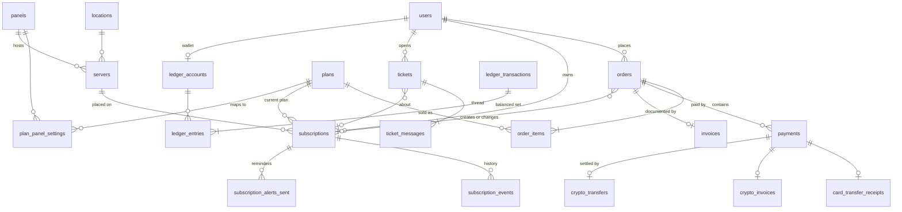

# مرحله‌ی ۲: طراحی دیتابیس

> وضعیت: **تأییدشده.** طرح کامل در [`02-schema.sql`](02-schema.sql) است. این سند توضیح می‌دهد چرا به این شکل است. نقشه‌ی راه در [مرحله‌ی ۳](03-roadmap.md) است.

## خلاصه

- **۶۶ جدول** در ۱۳ ماژول: **۴۲ جدول برای فاز اول (MVP)** و ۲۴ جدول برای فازهای بعد. جدول‌های فاز بعد از حالا طراحی شده‌اند تا فاز اول چیزی نسازد که بعداً مجبور به شکستنش شویم.
- **طرح اجرا و آزموده شده است.** فایل SQL روی یک PostgreSQL 17 واقعی (PGlite) بارگذاری شد: ۶۶ جدول، ۳۲ enum، ۱۶۳ ایندکس و ۱۰۸ کلید خارجی. بعد ۴۴ مورد آزموده شد؛ بیشترشان کارهای غیرمجاز بودند (مثل دو پرداخت موفق برای یک سفارش، منفی شدن کیف پول، یا دو فاکتور ارز دیجیتال منتظر یک مبلغ) و **دیتابیس همه را رد کرد.** اجرای دوباره: `cd docs/schema-check && npm install && npm run verify`.

## پاسخ‌های شما و اثرشان روی طرح

| پاسخ | اثر روی طرح |
|---|---|
| ارز پایه تومان است | همه‌ی ستون‌های مالی `bigint` به تومان‌اند و نامشان با `_toman` تمام می‌شود. زرین‌پال با ریال کار می‌کند؛ تبدیل فقط در آداپتر زرین‌پال انجام می‌شود. |
| زبان فارسی | `locale` پیش‌فرض `fa` است. محتوا (وبلاگ، آموزش‌ها، صفحات) برای هر زبان یک ردیف دارد که با `translation_group_id` به هم وصل‌اند. اگر روزی انگلیسی لازم شد، طرح دیتابیس تغییر نمی‌کند. |
| پیامک لازم نیست، ایمیل کافی است | ستون شماره تلفن و کانال پیامک حذف شد. ورود با ایمیل و کد یک‌بارمصرف (در Redis). |
| میزبانی خارج از ایران | ربات تلگرام مشکلی ندارد. یک ریسک جدید: بررسی اینکه API زرین‌پال درخواست از IP خارجی را قبول می‌کند (پایین‌تر). |
| مقیاس تا ۱۰٬۰۰۰ کاربر در سال | هیچ جدولی به partitioning نیاز ندارد. بزرگ‌ترین جدول، مصرف روزانه، در سال چند میلیون ردیف دارد که برای PostgreSQL کوچک است. |
| حساب‌های فعلی پاک شوند | **مهاجرت داده انجام نمی‌شود.** دیتابیس جدید خالی شروع می‌شود و فقط یک حساب مالک با اسکریپت ساخته می‌شود. MongoDB فعلی در زمان جایگزینی کنار گذاشته می‌شود. |
| پلن‌ها بر اساس حجم و زمان | هر پلن `data_limit_bytes` و `duration_days` دارد. پلن‌های فعلی (فقط زمانی) منتقل نمی‌شوند؛ پلن‌های جدید از داشبورد تعریف می‌شوند. |
| نرخ USDT خودکار از نوبیتکس | جدول `exchange_rates`؛ هر فاکتور ارز دیجیتال به نرخی که با آن صادر شده اشاره می‌کند. |
| ارز دیجیتال: هم NOWPayments، هم USDT مستقیم روی TRON | دو روش پرداخت جدا (`nowpayments` و `usdt_tron`)، هر کدام با حساب جدا در دفتر مالی، و یک جدول جدید برای انتقال‌های دیده‌شده روی بلاک‌چین (بخش «ارز دیجیتال: دو مسیر»). |

## قراردادهای کلی

| موضوع | قرارداد | دلیل |
|---|---|---|
| شناسه‌ها | `uuid` که برنامه به‌صورت **UUIDv7** می‌سازد | ترتیب زمانی دارد، پس درج در ایندکس پراکنده نیست. قابل حدس هم نیست، پس کسی نمی‌تواند با عوض کردن عدد در URL سفارش دیگران را ببیند. |
| شماره‌های قابل خواندن | سفارش از ۱۰۰۰۰۱، فاکتور از ۱۰۰۰۰۱، تیکت از ۱۰۰۱ | کوتاه و قابل خواندن پشت تلفن. جدا از شناسه. |
| پول | `bigint` به تومان، هرگز اعشاری | خطای گرد کردن در پول، ضرر مالی است. |
| حجم | `bigint` به بایت | همان واحد PasarGuard؛ هیچ تبدیلی بین دو سیستم لازم نیست. |
| زمان | `timestamptz` به UTC | نمایش شمسی و به وقت تهران فقط در لایه‌ی نمایش انجام می‌شود. |
| وضعیت‌ها | enum در PostgreSQL | مقدار نامعتبر حتی با یک باگ در کد هم ذخیره نمی‌شود. |
| حذف | پلن‌ها و سرورها **بایگانی** می‌شوند، حذف نمی‌شوند؛ سفارش‌ها و اشتراک‌ها به آن‌ها اشاره می‌کنند | درس از همین پروژه: حذف محصولات قبلاً عکس فاکتورهای قدیمی را خراب کرد. |

## نمودار ارتباط جدول‌های اصلی

جدول‌های مسیر اصلی «خرید ← پرداخت ← تحویل سرویس». بقیه در فهرست ماژول‌ها آمده‌اند.

## ماژول‌ها و جدول‌ها

علامت‌ها: **MVP** یعنی فاز اول؛ **بعد** یعنی فاز بعدی.

### هویت و دسترسی
| جدول | کار | فاز |
|---|---|---|
| `users` | حساب همه: مشتری، کارمند، نماینده. ایمیل بدون حساسیت به حروف بزرگ و کوچک یکتا است. | MVP |
| `user_recovery_codes` | کدهای پشتیبان ورود دومرحله‌ای | MVP |
| `roles`، `role_permissions`، `user_roles` | نقش‌های قابل ویرایش. مجوزها (مثل `payments:approve`) در کد تعریف می‌شوند. | MVP |
| `audit_logs` | لاگ اقدامات. **فقط افزودنی**: trigger اجازه‌ی ویرایش و حذف نمی‌دهد. | MVP |
| `api_tokens` | توکن ربات و API نماینده؛ فقط hash ذخیره می‌شود | بعد |

### زیرساخت و پنل VPN
| جدول | کار | فاز |
|---|---|---|
| `panels` | هر نمونه‌ی پنل: درایور، آدرس، credential رمزنگاری‌شده | MVP |
| `locations`، `servers` | سرور = جایی که مشتری روی آن قرار می‌گیرد، هزینه دارد و سود به آن نسبت داده می‌شود. در PasarGuard یعنی یک node که دسترسی به آن از طریق group داده می‌شود. | MVP |
| `server_health_checks`، `server_costs`، `status_incidents` | مانیتورینگ، هزینه‌ی ماهانه برای محاسبه‌ی سود، صفحه‌ی وضعیت | بعد |
| `server_migrations` | جابه‌جایی گروهی کاربران بین سرورها، قابل ادامه بعد از قطعی | بعد |

### پلن‌ها
| جدول | کار | فاز |
|---|---|---|
| `plans` | حجم (`null` = نامحدود)، مدت به روز، محدودیت دستگاه، قیمت به تومان. **حداکثر یک پلن تست فعال** و **پلن تست قیمت ندارد**، هر دو با constraint. | MVP |
| `plan_panel_settings` | هر پلن روی هر پنل به کدام groupها دسترسی می‌دهد | MVP |

### اشتراک‌ها
| جدول | کار | فاز |
|---|---|---|
| `subscriptions` | سرویس مشتری: وضعیت، محدودیت‌های فعلی، کپی مصرف از پنل، لینک اختصاصی | MVP |
| `subscription_events` | هر اتفاقی که برای سرویس افتاده، از جمله کارهای خودکار سیستم. پشتیبان کنار تیکت می‌بیند. | MVP |
| `subscription_alerts_sent` | «هر یادآوری فقط یک بار در هر دوره». با تمدید، دوره‌ی جدید شروع می‌شود. | MVP |
| `usage_daily` | مصرف روزانه برای نمودار و تحلیل | بعد |
| `trial_claims` | یک تست رایگان برای هر نفر: ایمیل نرمال‌شده و حساب تلگرام هر کدام یکتا | بعد |

### مالی
| جدول | کار | فاز |
|---|---|---|
| `orders`، `order_items` | سفارش و اقلامش. **مشخصات پلن هنگام فروش کپی می‌شود**، پس ویرایش پلن، فروش گذشته را تغییر نمی‌دهد. | MVP |
| `payments` | هر تلاش پرداخت. **فقط یکی می‌تواند برای هر سفارش موفق باشد.** | MVP |
| `payment_cards`، `card_transfer_receipts` | کارت‌های مقصد و رسیدها. رسید تکراری **علامت‌گذاری** می‌شود، رد نمی‌شود؛ تصمیم با حسابدار است. | MVP |
| `crypto_invoices` | فاکتور ارز دیجیتال برای هر دو روش. نرخ هنگام صدور قفل می‌شود و فاکتور زمان انقضا دارد. | MVP |
| `crypto_transfers` | هر انتقال USDT که به کیف پول TRON ما رسیده، چه با فاکتوری جور شده باشد چه نه | MVP |
| `exchange_rates` | نرخ USDT به تومان از نوبیتکس؛ نرخ کهنه پرداخت ارز دیجیتال را متوقف می‌کند | MVP |
| `invoices` | سند نهایی. **بعد از صدور قابل تغییر نیست** (با trigger). | MVP |
| `discount_codes`، `discount_code_plans`، `discount_redemptions` | کد تخفیف. مصرف کد **هنگام پرداخت** ثبت می‌شود، نه هنگام ساخت سفارش؛ پس سبدهای رهاشده سهمیه‌ی کد را هدر نمی‌دهند. | بعد |
| `ledger_accounts`، `ledger_transactions`، `ledger_entries` | دفتر مالی دوطرفه (پایین‌تر) | MVP |
| `withdrawal_requests` | برداشت از کیف پول یا پورسانت | بعد |

### همکاری در فروش (همه در فاز بعد)
`resellers` (با امکان چندسطحی)، `reseller_plan_prices` (قیمت عمده برای هر نماینده و پلن)، `affiliate_profiles`، `commissions`. پورسانت تا پایان مهلت بازپرداخت در حالت «در انتظار» می‌ماند تا اگر سفارش برگشت خورد، پورسانت برگردد و از قبل پرداخت نشده باشد. هر سفارش هر نوع پورسانت را فقط یک بار به هر نفر می‌دهد.

### اعلان‌ها
| جدول | کار | فاز |
|---|---|---|
| `notification_templates` | قالب‌های قابل ویرایش از داشبورد، برای هر کانال و زبان | MVP |
| `notifications` | هر پیام ارسال‌شده، یا ارسال‌نشده و دلیلش. در پروفایل مشتری دیده می‌شود. | MVP |
| `segments`، `campaigns`، `automation_rules` | سگمنت، کمپین، اتوماسیون بازگرداندن مشتری | بعد |

### پشتیبانی
| جدول | کار | فاز |
|---|---|---|
| `tickets` | وضعیت یعنی **منتظر چه کسی است** (`awaiting_staff` / `awaiting_customer`)، نه «باز» مبهم. به اشتراک مربوط وصل می‌شود. | MVP |
| `ticket_messages`، `ticket_message_files`، `ticket_categories` | گفت‌وگو، پیوست، دسته. یادداشت داخلی فقط از طرف کارمند ممکن است. | MVP |
| `canned_responses` | پاسخ‌های آماده | بعد |

### CRM و محتوا
| جدول | کار | فاز |
|---|---|---|
| `customer_profiles`، `customer_notes`، `tags`، `customer_tags` | CRM فعلی، منتقل‌شده به PostgreSQL. ارزش مشتری و مرحله‌ی چرخه‌ی عمر مثل الان هنگام خواندن محاسبه می‌شوند، ذخیره نمی‌شوند. | MVP |
| `posts`، `post_likes`، `post_comments` | ژورنال فعلی | MVP |
| `tutorials`، `faqs`، `pages`، `testimonials` | آموزش هر سیستم‌عامل، سؤالات متداول، صفحات قانونی و فرود، نظرات | بعد |
| `files`، `site_settings` | فایل‌ها (رسید و پیوست خصوصی‌اند) و تنظیمات سایت | MVP |

### زیرساخت نرم‌افزار
| جدول | کار | فاز |
|---|---|---|
| `outbox_events` | صندوق خروجی؛ کار ساخت سرویس در همان تراکنش پرداخت اینجا نوشته می‌شود | MVP |
| `risk_flags` | موارد مشکوک برای بررسی انسانی | بعد |

## دفتر مالی دوطرفه

هر جابه‌جایی پول یک «تراکنش» با دو یا چند ردیف است که **جمعشان صفر است.** موجودی هر حساب جمع ردیف‌های آن است.

**قرارداد علامت:** پول از ردیف منفی به ردیف مثبت می‌رود.

| رویداد | ردیف‌ها |
|---|---|
| خرید پلن ۱۰۰ هزار تومانی با زرین‌پال | زرین‌پال −۱۰۰ · درآمد +۱۰۰ |
| همان خرید با ۲۰ تخفیف روی پلن ۱۲۰ | زرین‌پال −۱۰۰ · تخفیف −۲۰ · درآمد +۱۲۰ |
| شارژ کیف پول ۱۰۰ | زرین‌پال −۱۰۰ · کیف پول مشتری +۱۰۰ |
| خرید ۱۰۰ از کیف پول | کیف پول مشتری −۱۰۰ · درآمد +۱۰۰ |

سه تضمین را **خود دیتابیس** می‌دهد، نه کد برنامه:
1. **تراکنش نامتوازن ثبت نمی‌شود.** یک constraint trigger معوق در لحظه‌ی commit جمع را بررسی می‌کند.
2. **کیف پول، اعتبار نماینده و موجودی پورسانت منفی نمی‌شوند.** موجودی با trigger و در همان دستور به‌روز می‌شود. آن `UPDATE` سطر حساب را قفل می‌کند، پس دو خرید هم‌زمان پشت هم صف می‌شوند و دومی به‌جای خرج کردن پولی که دیگر نیست، رد می‌شود.
3. **تاریخچه قابل ویرایش نیست.** اصلاح یعنی یک تراکنش معکوس جدید.

این جدول‌ها در فاز اول ساخته می‌شوند، هرچند صفحه‌ی کیف پول در فاز بعد است. به این ترتیب درآمد از اولین فروش در دفتر ثبت است و چیزی برای پر کردن بعدی نمی‌ماند.

## ارز دیجیتال: دو مسیر

| | NOWPayments | USDT مستقیم روی TRON |
|---|---|---|
| آدرس پرداخت | هر فاکتور آدرس خودش را از NOWPayments می‌گیرد | همه‌ی فاکتورها به **یک** آدرس کیف پول ما پرداخت می‌شوند |
| از کجا می‌فهمیم پرداخت شده | callback امضاشده (IPN). **فقط به‌عنوان اشاره**؛ وضعیت قبل از ثبت، از API خودشان دوباره خوانده می‌شود، مثل verify زرین‌پال | worker تراکنش‌های ورودی آدرس را از بلاک‌چین می‌خواند (مثلاً هر ۳۰ ثانیه) |
| کدام پرداخت مال کدام فاکتور است | شناسه‌ی پرداخت NOWPayments | **مبلغ دقیق.** هر فاکتور چند واحد کوچک اضافه دارد (مثلاً ۱۲٫۰۰۰۳۴۷ به‌جای ۱۲). یک ایندکس یکتا نمی‌گذارد دو فاکتور باز منتظر یک مبلغ روی یک آدرس باشند. |
| کارمزد و واسطه | کارمزد NOWPayments؛ ممکن است برای کاربران ایرانی محدودیت داشته باشد | بدون واسطه؛ نگهداری کلید کیف پول با ما است |

سه نکته‌ی امنیتی و عملیاتی در مسیر مستقیم:

1. **توکن با آدرس قرارداد شناخته می‌شود، نه با نام.** هر کسی می‌تواند توکنی بی‌ارزش بسازد و اسمش را «USDT» بگذارد. فقط انتقال‌های قرارداد رسمی USDT قبول می‌شوند (`token_contract`).
2. **فقط انتقال‌های نهایی‌شده** (confirmed) با فاکتور جور می‌شوند.
3. **هیچ پولی گم نمی‌شود.** هر انتقال دیده‌شده اول در `crypto_transfers` ثبت می‌شود، بعد جور می‌شود. مشتری‌ای که مبلغ اشتباه فرستاده یا بعد از انقضای فاکتور پرداخته، در صف بررسی کارمند با وضعیت `wrong_amount`، `late` یا `unmatched` دیده می‌شود. کارمند تصمیم می‌گیرد: به کیف پول مشتری اضافه شود، برگردانده شود، یا کنار گذاشته شود.

### نرخ تبدیل تومان به USDT

نرخ به‌صورت خودکار از API عمومی نوبیتکس خوانده می‌شود (تصمیم شما). هر نرخ خوانده‌شده در جدول `exchange_rates` ثبت می‌شود و هر فاکتور ارز دیجیتال به همان نرخی اشاره می‌کند که با آن صادر شده؛ پس قیمت هر فاکتور تا منبعش قابل پیگیری است.

- **آدرس درست API:** `apiv2.nobitex.ir`. آدرس قدیمی `api.nobitex.ir`، که بیشتر آموزش‌ها و کتابخانه‌ها هنوز از آن استفاده می‌کنند، **از خارج ایران اصلاً resolve نمی‌شود** (هم Google و هم Cloudflare جواب NXDOMAIN می‌دهند). از یک اتصال خارجی آزمودم: `apiv2` جواب می‌دهد. آدرس در تنظیمات است، نه در کد.
- **واحد:** نوبیتکس به **ریال** قیمت می‌دهد (مثلاً `2,521,600`)؛ قبل از ذخیره بر ۱۰ تقسیم می‌شود (۲۵۲٬۱۶۰ تومان).
- **کدام قیمت:** فاکتور با `bestBuy` صادر می‌شود، یعنی قیمتی که بازار USDT را از ما می‌خرد. پس تبدیل USDT دریافتی به تومان هیچ‌وقت به ضرر کسب‌وکار نیست. اختلاف دو طرف بازار در لحظه‌ی آزمون حدود ۰٫۰۲٪ بود.
- **محافظ نرخ کهنه:** اگر آخرین نرخ از چند دقیقه قدیمی‌تر باشد، یا نوبیتکس بازار را بسته اعلام کند (`isClosed`)، پرداخت ارز دیجیتال موقتاً غیرفعال می‌شود. **چون نرخ دستی انتخاب نشد، در قطعی نوبیتکس پرداخت ارز دیجیتال متوقف می‌ماند** تا نرخ دوباره برسد. زرین‌پال و کارت‌به‌کارت در این مدت کار می‌کنند.

## نگاشت اشتراک به PasarGuard

| ستون ما | فیلد پنل | نکته |
|---|---|---|
| `panel_username` | `username` | از شناسه‌ی اشتراک ساخته می‌شود، **نه تصادفی**. تلاش مجدد، کاربر ساخته‌شده را پیدا می‌کند به‌جای ساختن کاربر دوم. یکتایی در هر پنل با constraint تضمین می‌شود. |
| `panel_user_id` | `id` | |
| `data_limit_bytes` | `data_limit` | `null` در طرف ما = `0` (نامحدود) در پنل |
| `expires_at` | `expire` | |
| `starts_on_first_use` | `status: on_hold` + `on_hold_expire_duration` | |
| `device_limit` | `hwid_limit` | |
| `plan_panel_settings.group_ids` | `group_ids` | در پنل تست شما یک group به نام `tunnel` هست |
| `used_bytes`، `lifetime_used_bytes`، `online_at` | `used_traffic`، `lifetime_used_traffic`، `online_at` | کپی. **پنل منبع حقیقت مصرف است.** |
| `panel_subscription_url` | `subscription_url` | لینکی که مشتری می‌گیرد `/s/{access_token}` روی دامنه‌ی ما است |

## ایندکس‌های مهم

هر ایندکس برای یک کار مشخص است، نه «برای احتیاط»:

| ایندکس | برای چه کاری |
|---|---|
| `subscriptions (expires_at)` فقط برای سرویس‌های زنده | اسکن ساعتی یادآوری انقضا |
| `subscriptions (server_id)` فقط برای سرویس‌های زنده | شمارش بار هر سرور برای انتخاب سرور مشتری جدید |
| `payments (order_id)` یکتا فقط برای `succeeded` | دو پرداخت نمی‌توانند یک سفارش را تسویه کنند |
| `payments (method, provider_reference)` یکتا | callback تکراری درگاه دو بار حساب نمی‌شود |
| `payments (status, created_at)` فقط برای پرداخت‌های باز | job استعلام پرداخت‌های معلق و صف بررسی رسیدها |
| `orders (user_id, idempotency_key)` یکتا | تکرار درخواست خرید، سفارش دوم نمی‌سازد |
| `tickets (priority, last_message_at)` فقط برای `awaiting_staff` | صف پشتیبانی: فوری‌ترین و قدیمی‌ترین اول |
| `outbox_events (id)` فقط برای منتشرنشده‌ها | relay فقط ردیف‌های منتظر را می‌خواند، هر چقدر هم جدول بزرگ شود |
| `card_transfer_receipts (image_sha256)` و `(tracking_number)` | پیدا کردن رسید تکراری |

بیشتر ایندکس‌ها **جزئی** (partial) هستند: فقط ردیف‌هایی را نگه می‌دارند که آن کار واقعاً می‌خواند. این‌طوری کوچک می‌مانند و با رشد تاریخچه کند نمی‌شوند.

## آنچه در دیتابیس نیست

در **Redis** با زمان انقضا نگه داشته می‌شوند: کد یک‌بارمصرف ورود، توکن اتصال حساب تلگرام، session، شمارنده‌های rate limit، صف‌ها.

## آنچه آزموده شد و آنچه هنوز نه

**آزموده شد (۴۴ مورد، همه برقرار):**
- **رد شدند:** نرخ خراب (قیمت خرید بالاتر از فروش، یا صفر)، فاکتور ارز دیجیتال بدون نرخ مرجع، ایمیل تکراری با حروف متفاوت، سفارش با جمع اشتباه، تمدید بدون اشتراک مقصد، سفارش تکراری با همان کلید، پرداخت موفق دوم برای یک سفارش، callback تکراری، دو فاکتور باز TRON منتظر یک مبلغ روی یک آدرس، ثبت دوباره‌ی یک انتقال بلاک‌چین، انتقال «جورشده» بدون پرداخت، تسویه‌ی یک پرداخت با دو انتقال، تراکنش مالی نامتوازن، منفی شدن کیف پول، ثبت دوباره‌ی یک رویداد مالی، ویرایش یا حذف دفتر مالی، ویرایش فاکتور صادرشده، ویرایش یا حذف audit log، نام کاربری تکراری روی پنل، یادآوری تکراری در یک دوره، دومین پلن تست فعال، پلن تست با قیمت، پیام داخلی از طرف مشتری.
- **پذیرفته شدند، همان‌طور که باید:** تراکنش متوازن، به‌روزرسانی موجودی، یادآوری در دوره‌ی جدید بعد از تمدید، استفاده‌ی دوباره از مبلغ بعد از بسته شدن فاکتور، نگه داشتن انتقالی که با هیچ فاکتوری جور نیست.

**هنوز آزموده نشده و در مرحله‌ی ۴ آزموده می‌شود:**
- **هم‌زمانی واقعی.** PGlite فقط یک اتصال دارد، پس «دو خرید در یک لحظه» را نمی‌توان با آن امتحان کرد. رفتار قفل سطر رفتار استاندارد PostgreSQL است، ولی در مرحله‌ی ۴ روی PostgreSQL واقعی با دو اتصال هم‌زمان تست می‌شود.
- **قوانینی که در کد اعمال می‌شوند، نه در دیتابیس:** سقف مصرف کد تخفیف برای هر کاربر، و بررسی IP و اثر انگشت دستگاه برای تست رایگان.

## نگهداری داده

| داده | مدت |
|---|---|
| audit log، دفتر مالی، فاکتور، سفارش | همیشه |
| `server_health_checks` | ۳۰ روز؛ job شبانه پاک می‌کند |
| `notifications` | یک سال |
| حساب حذف‌شده | ایمیل و نام ناشناس می‌شوند؛ سفارش و دفتر مالی برای حسابداری می‌مانند |

## یک یافته از پنل تستی شما

حسابی که فرستادید نقش **operator** دارد، نه مالک. یعنی فقط کاربرانی را می‌بیند و مدیریت می‌کند که خودش ساخته. این برای یکپارچه‌سازی دقیقاً درست است و **پیشنهاد می‌کنم در production هم CRM با یک حساب operator جدا کار کند، نه حساب مالک.**

دو محدودیت این نقش:
- **نمی‌تواند webhook تنظیم کند** (دسترسی به settings ندارد). همگام‌سازی دوره‌ای که از قبل منبع اطمینان بود کافی است. اگر webhook را برای سرعت بیشتر می‌خواهید، مالک پنل باید آن را یک بار تنظیم کند.
- **نمی‌تواند nodeها را بخواند.** برای مانیتورینگ سرورها یا مجوز `nodes:read` به این نقش اضافه شود، یا بررسی سلامت را خودمان انجام می‌دهیم (طراحی فعلی هر دو را پشتیبانی می‌کند).

## سؤال باز

همه‌ی سؤال‌های این مرحله پاسخ گرفته‌اند.
