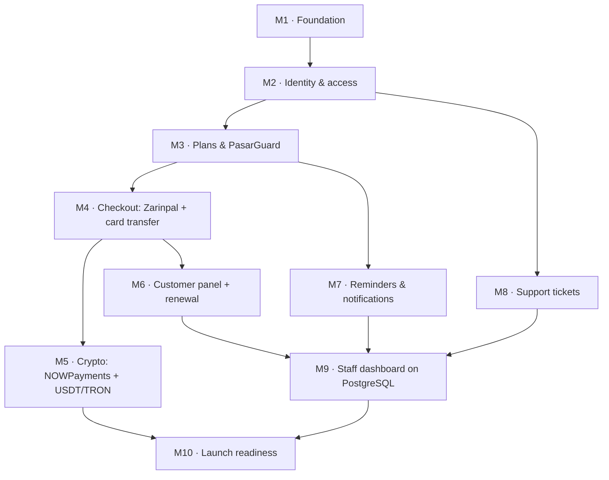

# مرحله‌ی ۳: نقشه‌ی راه

> وضعیت: **پیش‌نویس برای تأیید.** معماری در [مرحله‌ی ۱](01-architecture.md) و دیتابیس در [مرحله‌ی ۲](02-database.md) تأیید شده‌اند.

## خلاصه

- **فاز ۱ (MVP)** همان چیزی است که تعیین کردید: ثبت‌نام و ورود، تعریف پلن، پرداخت، اتصال خودکار به PasarGuard و تحویل فوری سرویس، پنل کاربری ساده، یادآوری انقضا و تیکتینگ. به‌علاوه‌ی کارهایی که بدون آن‌ها این موارد قابل عرضه نیستند (پایین‌تر، «سه افزوده به MVP»).
- فاز ۱ به **۱۰ نقطه‌ی تحویل** (milestone) تقسیم شده است. هر نقطه به‌تنهایی قابل اجرا و آزمودن است. **بعد از هر نقطه منتظر تأیید شما می‌مانم**، همان‌طور که برای مرحله‌ها خواستید.
- بقیه‌ی قابلیت‌ها در **۶ فاز بعدی**، به ترتیبی که بیشترین درآمد را زودتر می‌آورد. ترتیب فازهای بعد از MVP پیشنهاد من است و تصمیم آن با شما است.
- **تقویم نمی‌دهم، اندازه‌ی نسبی می‌دهم** (کوچک / متوسط / بزرگ). تخمین روز و هفته برای کاری در این اندازه قبل از شروع، حدس است و به‌جای برنامه‌ریزی، انتظار غلط می‌سازد.

## فاز ۱: MVP

### چه چیزی تحویل می‌شود

یک مشتری با ایمیل ثبت‌نام می‌کند، یک پلن حجمی-زمانی را با زرین‌پال، کارت‌به‌کارت یا ارز دیجیتال می‌خرد و **چند ثانیه بعد از پرداخت** لینک اشتراک و QR Code را می‌گیرد. در پنلش حجم و روزهای باقی‌مانده را می‌بیند، قبل از انقضا ایمیل یادآوری می‌گیرد، می‌تواند تمدید کند و تیکت ثبت کند. تیم داخلی پلن‌ها و سرورها را تعریف می‌کند، رسیدها و انتقال‌های ارز دیجیتال را بررسی می‌کند، تیکت‌ها را جواب می‌دهد و فروش را در داشبورد فعلی می‌بیند.

### سه افزوده به MVP (نیاز به تأیید شما)

این‌ها در فهرست MVP شما نبودند، ولی بدون آن‌ها فهرست قابل عرضه نیست:

| افزوده | چرا لازم است |
|---|---|
| **تمدید ساده** (خرید دوباره‌ی همان پلن برای همان سرویس) | یادآوری انقضا بدون امکان تمدید، مشتری را به خرید یک سرویس جدید با لینک جدید می‌فرستد و باید همه‌ی دستگاه‌هایش را دوباره تنظیم کند. تمدید ساده همان مسیر خرید است با یک اشتراک مقصد؛ ارتقا، افزودن حجم و تمدید خودکار در فاز ۲ می‌مانند. |
| **فارسی‌سازی و راست‌چین کل سایت** | زبان سایت فارسی است و رابط فعلی انگلیسی است. زیرساخت آن در اولین نقطه ساخته می‌شود تا هر صفحه‌ی جدید از اول فارسی ساخته شود، نه اینکه بعداً دوباره کار شود. |
| **صفحات قانونی ساده** (قوانین، حریم خصوصی، بازپرداخت) | درگاه‌های پرداخت معمولاً قبل از فعال کردن حساب، وجود این صفحات را بررسی می‌کنند. در MVP متن ثابت‌اند؛ مدیریتشان از داشبورد در فاز ۶ است. |

### ترتیب نقاط تحویل

`M5` (ارز دیجیتال) و `M6`–`M8` به هم وابسته نیستند و ترتیبشان قابل جابه‌جایی است. اگر فروش با زرین‌پال و کارت‌به‌کارت برای شروع کافی باشد، `M5` می‌تواند آخر بیاید.

### نقاط تحویل

#### M1 · زیرساخت — بزرگ · ✅ انجام شد

> **تفاوت با برنامه، با دلیل:**
> - نام پوشه‌ها `back-end` و `front-end` ماند (به‌جای `apps/server` و `apps/web`). تغییر نام ارزشی نداشت و همه‌ی فایل‌های باز و عادت‌ها را می‌شکست.
> - به‌جای pnpm، **npm workspaces**. pnpm نصب نبود و فعال کردنش روی Windows دسترسی مدیر می‌خواست؛ npm workspaces چیزی اضافه لازم ندارد.
> - **PostgreSQL 18** به‌جای ۱۷. تا ۲۰۳۰ پشتیبانی می‌شود و `uuidv7()` را خودش دارد.
> - نقش `scheduler` حذف شد. در BullMQ 6 زمان‌بندی کارهای تکرارشونده در Redis نگه داشته می‌شود و خود workerها اجرایشان می‌کنند؛ یک پروسه‌ی جدا فقط تنظیمات را نگه می‌داشت.
- ساختن مخزن git (پیش‌نیاز همه‌چیز)
- monorepo با pnpm: `back-end` به `apps/server` و `front-end` به `apps/web` منتقل می‌شوند؛ پکیج `packages/contracts` برای schemaهای zod مشترک
- TypeScript در سرور (تدریجی)؛ PostgreSQL با Drizzle و migration برای **۴۲ جدول MVP** از روی [`02-schema.sql`](02-schema.sql)
- Redis، BullMQ، صندوق خروجی (outbox) و relay آن؛ نقش‌های اجرایی `api` / `worker` / `scheduler`
- Docker Compose برای محیط توسعه (PostgreSQL + Redis)
- زیرساخت چندزبانی و راست‌چین در فرانت (i18next، `dir="rtl"`، فونت فارسی، کلاس‌های منطقی Tailwind)
- یک دستور برای lint + typecheck + همه‌ی تست‌ها
- **آزمون پذیرش:** `docker compose up` و `pnpm test` روی یک سیستم تمیز کار می‌کنند؛ یک رویداد outbox وقتی Redis خاموش است نوشته می‌شود و بعد از روشن شدن Redis به صف می‌رسد.

#### M2 · هویت و دسترسی — متوسط · ✅ انجام شد

> **تفاوت با برنامه، با دلیل:**
> - **داشبورد فعلی (`/dashboard`) هنوز با حساب‌های قدیمی (MongoDB) کار می‌کند.** شرط «کارمند بدون ورود دومرحله‌ای راه ندارد» روی API جدید (`/api/v1/staff`) اعمال و تست شده است؛ هر بخش داشبورد وقتی در مایل‌استون خودش به API جدید منتقل شود، همین قفل را می‌گیرد. جابه‌جایی همه‌ی داشبورد در M2 یعنی بازنویسی بخش‌هایی که قرار است در M3 تا M9 عوض شوند.
> - ایمیل‌ها (از جمله کد ورود) از **صف BullMQ** می‌روند، نه از outbox؛ تا کد ورود هرگز در PostgreSQL ذخیره نشود.
> - session store را خودمان نوشتیم (`connect-redis` نسخه‌ی ۱۰ با `ioredis` سازگار نیست).
> - صفحه‌ی مدیریت نقش‌ها در داشبورد ساخته نشد؛ API آن آماده و تست‌شده است و صفحه‌اش با داشبورد جدید می‌آید.
> - **یک باگ واقعی در تست قرارداد فرانت پیدا و رفع شد:** اولین درخواست کد ورود بعد از روشن شدن سرور خطای ۵۰۰ می‌داد (اتصال Redis صف ایمیل هنوز برقرار نشده بود). تست رگرسیون اضافه شد.
- ثبت‌نام و ورود با ایمیل + رمز، **و** ورود با کد یک‌بارمصرف ایمیلی؛ تأیید ایمیل؛ بازیابی رمز
- session در Redis؛ محدودیت نرخ برای ورود و ارسال کد
- نقش‌ها و مجوزها؛ **ورود دومرحله‌ای اجباری برای کارمندان**؛ audit log
- اسکریپت ساخت حساب مالک (دیتابیس خالی شروع می‌شود)
- **آزمون پذیرش:** کارمند بدون ورود دومرحله‌ای به داشبورد راه ندارد؛ پنج تلاش ناموفق ورود، حساب را موقتاً قفل می‌کند؛ هر تغییر نقش در audit log ثبت می‌شود.

#### M3 · پلن‌ها و اتصال به PasarGuard — بزرگ · ✅ انجام شد

> **تصمیم‌های شما در این مرحله:** صفحه‌های مدیریت در بخش جدید `/staff` ساخته شدند (نه داخل داشبورد قدیمی)؛ زمان پلن از اولین اتصال مشتری شروع می‌شود و اگر تا ۳۰ روز وصل نشود، خودکار شروع می‌شود.
>
> **تفاوت با برنامه، با دلیل:**
> - **حساب پنل تستی (operator) نمی‌تواند کلید API بسازد و به nodeها دسترسی ندارد.** پس درایور با نام کاربری و رمز وارد می‌شود (کلید API هم پشتیبانی می‌شود)، و وضعیت سرور را کارمند تعیین می‌کند؛ سلامت خود پنل خودکار بررسی می‌شود.
> - **webhook پنل استفاده نشد.** این حساب اجازه‌ی تنظیم webhook ندارد. همگام‌سازی هر ۵ دقیقه، به‌اضافه‌ی دکمه‌ی «همگام‌سازی الان»، جایش را می‌گیرد. طراحی هم از اول webhook را فقط «اشاره» می‌دانست.
> - «مصرف در CRM» در صفحه‌ی مشتری بخش جدید `/staff` دیده می‌شود؛ CRM قدیمی روی حساب‌های قدیمی است.
> - هشدار به مدیر بعد از شکست ساخت، طبق برنامه در M4 می‌آید. فعلاً اشتراک «ساخت ناموفق» در داشبورد با دکمه‌ی «تلاش دوباره» دیده می‌شود.
> - **آزمون پذیرش خودکار شد** (`npm run test:contract`): اشتراک از API ساخته می‌شود، روی پنل تستی ظاهر می‌شود، لینک `/s/…` ما پیکربندی‌هایی برمی‌گرداند که v2rayNG وارد می‌کند، و همگام‌سازی کار می‌کند. **عبور ترافیک واقعی** با یک اپ VPN را باید با دست امتحان کرد.
- تعریف پنل، لوکیشن و سرور از داشبورد؛ credential رمزنگاری‌شده
- تعریف پلن حجمی-زمانی با محدودیت دستگاه؛ نگاشت پلن به groupهای پنل
- `PanelDriver` و `PasarGuardDriver`: ساخت، خواندن، ویرایش، ریست، ابطال لینک، فعال/غیرفعال، حذف، فهرست
- **تست قرارداد روی پنل تستی شما** (کاربران تستی می‌سازد و بعد پاک می‌کند)
- لینک اشتراک روی دامنه‌ی ما (`/s/{token}`) و پراکسی آن به پنل
- job همگام‌سازی مصرف؛ انتخاب سرور برای مشتری جدید بر اساس ظرفیت و اولویت
- **آزمون پذیرش:** یک اشتراک از داشبورد ساخته می‌شود، روی پنل تستی ظاهر می‌شود، لینک ما در یک کلاینت واقعی v2ray باز می‌شود و حجم مصرفی در CRM دیده می‌شود.

#### M4 · خرید و پرداخت: زرین‌پال و کارت‌به‌کارت — بزرگ · ✅ انجام شد

> **تصمیم‌های شما در این مرحله:** صفحه‌های فروش قدیمی (قیمت‌ها، سبد خرید، پرداخت) جایگزین شدند؛ هشدار به مدیر با ایمیل و تلگرام؛ زرین‌پال فعلاً sandbox؛ خریدار وسط خرید با کد ایمیلی وارد می‌شود.
>
> **نتیجه‌ی آزمون پذیرش** (`npm run test:contract`، با sandbox واقعی زرین‌پال و پنل تستی واقعی): از پرداخت تا نمایش لینک روی صفحه‌ی سفارش **۳٫۵ ثانیه**. با پنل خاموش، پول ثبت می‌ماند، بعد از حدود یک دقیقه به مدیر هشدار می‌رود و با روشن شدن پنل سرویس خودکار ساخته می‌شود. callback تکراری سرویس دوم نمی‌سازد.
>
> **تفاوت با برنامه، با دلیل:**
> - **آزمون زرین‌پال از سرور خارج از ایران هنوز انجام نشده**، چون هنوز سروری در خارج نداریم. این همان ریسکی است که مرحله‌ی ۱ شناخته بود و باید در M10 روی سرور واقعی امتحان شود.
> - تلگرام از ایران فیلتر است و از این‌جا با یک جایگزین آزمایشی تست شد. ایمیل‌ها مستقل از تلگرام می‌روند.
> - «هشدار بعد از چند شکست» یعنی بعد از ۶ تلاش (حدود یک دقیقه)، فقط یک بار. یک هشدار دیگر هم وقتی تلاش خودکار تمام شود.
> - endpointهای سبد خرید و سفارش قدیمی در بک‌اند (MongoDB) هنوز هستند ولی دیگر هیچ صفحه‌ای از آن‌ها استفاده نمی‌کند. با پاک‌سازی نهایی بک‌اند قدیمی حذف می‌شوند.
> - یک ستون به رسید کارت‌به‌کارت اضافه شد (مبلغی که مشتری اعلام می‌کند)، برای علامت‌گذاری خودکار «مبلغ نمی‌خواند».
- خرید حداکثر در سه قدم: انتخاب پلن ← روش پرداخت ← پرداخت
- سفارش با کلید idempotency؛ ثبت در دفتر مالی؛ فاکتور
- **زرین‌پال** (با آزمون زودهنگام درخواست از سرور خارجی؛ مرحله‌ی ۱ این را ریسک شناخته است)؛ استعلام دوره‌ای پرداخت‌های تأییدنشده
- **کارت‌به‌کارت:** آپلود رسید، صف بررسی حسابدار، علامت‌گذاری خودکار رسید تکراری و مبلغ نامطابق
- **تحویل خودکار:** outbox ← worker ← PasarGuard، با تلاش مجدد؛ هشدار به مدیر (ایمیل و تلگرام) بعد از چند شکست؛ دکمه‌ی «تلاش دوباره» در داشبورد
- صفحه‌ی موفقیت که بدون refresh، لینک و QR را به محض آماده شدن نشان می‌دهد
- **آزمون پذیرش:** از پرداخت در sandbox زرین‌پال تا نمایش QR کمتر از ۱۰ ثانیه؛ با پنل خاموش، پول ثبت می‌ماند، مدیر هشدار می‌گیرد و بعد از روشن شدن پنل سرویس خودکار ساخته می‌شود؛ callback تکراری سرویس دوم نمی‌سازد.

#### M5 · ارز دیجیتال: NOWPayments و USDT روی TRON — بزرگ · ✅ انجام شد (آزمون روی نایل منتظر شارژ کیف پول تستی)

> **تصمیم‌های شما در این مرحله:** NOWPayments ساخته شد و کلیدش را بعداً می‌دهید؛ آزمون TRON با دو کیف پول تستی نایل.
>
> **نتیجه‌ی آزمون پذیرش:**
> - با قطع نرخ، گزینه‌ی ارز دیجیتال از صفحه‌ی خرید حذف می‌شود و شروع پرداخت رد می‌شود: ✅ (تست). در عمل هم دیده شد: در همین مرحله نوبیتکس چند دقیقه از این‌جا در دسترس نبود.
> - توکن جعلی با نام USDT نادیده گرفته می‌شود، حتی ثبت هم نمی‌شود: ✅ (تست، در دو لایه: خواندن از TronGrid و دیده‌بان).
> - مبلغ دقیق سرویس را تحویل می‌دهد و مبلغ اشتباه در صف بررسی دیده می‌شود: ✅ با TronGrid جعلی. **آزمون همین روی نایل واقعی** (`test/m5-acceptance.contract.test.ts`) آماده است و تا کیف پول فرستنده (`TRJqp2T9pZeULj4B7Arbc37zqDKWT4aRkG`) از faucet نایل TRX و USDT تستی نگیرد، با همین پیام رد می‌شود.
>
> **تفاوت با برنامه، با دلیل:**
> - **NOWPayments** طبق مستنداتش ساخته و با نسخه‌ی جعلی تست شد. تا کلید و IPN secret در `.env` نباشد، در صفحه‌ی خرید نمایش داده نمی‌شود. «خواندن دوباره‌ی وضعیت» بعد از هر IPN انجام می‌شود. ولی پرداختی که IPNش هیچ‌وقت نرسد، خودکار استعلام نمی‌شود، چون API فهرست پرداخت‌های NOWPayments ورود جداگانه (JWT) می‌خواهد. NOWPayments خودش IPN ناموفق را دوباره می‌فرستد.
> - توکن جعلی روی زنجیره‌ی واقعی تست نشد، چون ساختن یک قرارداد توکن روی نایل لازم بود. با تست در دو لایه پوشش داده شد.
> - گزینه‌ی «واریز به کیف پول مشتری» برای انتقال‌های جورنشده ارائه نشد، چون خرج کردن از کیف پول هنوز ساخته نشده است. تصمیم‌ها: «تسویه‌ی همان سفارش»، «برگردانده شد»، «نادیده گرفتن».
> - برای هر انتقال دیرهنگام، فاکتوری که احتمالاً مال آن بوده ثبت می‌شود (migration 0004) تا تسویه‌اش یک کلیک باشد.
- job نرخ از `apiv2.nobitex.ir` و محافظ نرخ کهنه
- NOWPayments: فاکتور، بررسی امضای callback، خواندن دوباره‌ی وضعیت از API
- USDT مستقیم: نمایش آدرس و مبلغ دقیق، خواندن انتقال‌ها از بلاک‌چین، جور کردن با فاکتور، صف بررسی انتقال‌های جورنشده
- **آزمون پذیرش:** پرداخت روی testnet شبکه‌ی TRON (Nile) با مبلغ دقیق، سرویس را تحویل می‌دهد؛ مبلغ اشتباه در صف بررسی دیده می‌شود؛ توکن جعلی با نام USDT نادیده گرفته می‌شود؛ با قطع نرخ، گزینه‌ی ارز دیجیتال از صفحه‌ی خرید حذف می‌شود.

#### M6 · پنل کاربری و تمدید — متوسط · ✅ انجام شد

> **تصمیم‌های شما در این مرحله:** تمدید فوری است و چیزی از دست نمی‌رود: روزهای پلن به تاریخ انقضای فعلی و حجمش به حجم باقی‌مانده اضافه می‌شود. سرویس منقضی از امروز با حجم تازه شروع می‌شود. تمدید با هر پلنی که در حال فروش است ممکن است.
>
> **آزمون پذیرش:** ✅ بعد از تمدید، لینک مشتری همان است و کاربر پنل هم همان. فقط تاریخ (۳۰ روز بیشتر) و حجم (باقی‌مانده + حجم پلن) عوض می‌شوند. تست جدا: اگر پنل تمدید را گرفته باشد ولی جوابش گم شود، تلاش دوباره آن را دو بار اضافه نمی‌کند.
>
> **تفاوت با برنامه، با دلیل:**
> - «صفحه‌ی خانه و قیمت‌ها برای پلن‌های حجمی-زمانی» در M4 ساخته شد.
> - تمدید را worker روی پنل اعمال می‌کند، نه خود پرداخت. پس بعد از پرداخت چند ثانیه «در حال آماده‌سازی» دیده می‌شود. اگر پنل خاموش باشد، پول ثبت می‌ماند، به مدیر هشدار می‌رود و تمدید به محض برگشتن پنل اعمال می‌شود. کارمند هم از صفحه‌ی مشتری می‌تواند دوباره درخواستش کند.
> - «تنظیمات حساب» شامل نام نمایشی، رمز عبور و ورود دومرحله‌ای است. تغییر ایمیل ساخته نشد، چون ایمیل راه ورود است و تغییرش تأیید ایمیل تازه را لازم دارد. اگر لازم است بگویید.
> - برای نمایش «چند روز، از اولین اتصال» یک ستون به اشتراک‌ها اضافه شد (migration 0005)، که از پنل همگام می‌شود.
- سرویس‌های من: حجم باقی‌مانده، روزهای باقی‌مانده، وضعیت، لینک با دکمه‌ی کپی و QR
- تمدید ساده؛ تاریخچه‌ی پرداخت‌ها و فاکتورها؛ تنظیمات حساب
- صفحه‌ی خانه و قیمت‌ها برای پلن‌های حجمی-زمانی
- **آزمون پذیرش:** بعد از تمدید، لینک مشتری عوض نمی‌شود و فقط تاریخ و حجم به‌روز می‌شوند.

#### M7 · یادآوری و اعلان‌ها — متوسط · ✅ انجام شد

> **آزمون پذیرش:** ✅ با جلو بردن ساعت در تست، یادآوری‌ها ارسال شدند:
> - ۳ روز مانده و ۱ روز مانده
> - مصرف ۸۰٪ و ۱۰۰٪
>
> اسکن چند بار تکرار شد و هر کدام دقیقاً یک بار رفت. بعد از یک تمدید واقعی، یادآوری ۳ روز مانده برای دوره‌ی تازه دوباره فرستاده شد. یکتایی را کلید اصلی دیتابیس تضمین می‌کند، نه کد.
>
> **تفاوت با برنامه، با دلیل:**
> - ایمیل «سرویس تمدید شد» هم اضافه شد، کنار «سرویس آماده است» و «پرداخت دریافت شد».
> - قالب «پاسخ تیکت» در M7 آماده شد و ارسالش در M8 وصل شد.
> - اعلان‌ها فعلاً فقط ایمیل‌اند. تلگرام مشتری با ربات تلگرام در فاز بعد می‌آید. جدول‌ها از قبل کانال تلگرام را دارند.
> - یادآوری‌ها «لغو اشتراک» ندارند، چون درباره‌ی سرویس خود مشتری‌اند و ایمیل تبلیغاتی نیستند. کمپین‌های تبلیغاتی (فاز ۶) لغو اشتراک خواهند داشت.
- قالب‌های ایمیل فارسی و قابل ویرایش از داشبورد
- یادآوری ۳ روز و ۱ روز مانده، مصرف ۸۰٪ و ۱۰۰٪؛ هر یادآوری فقط یک بار در هر دوره
- ایمیل «سرویس آماده است»، «پرداخت دریافت شد»، «پاسخ تیکت»
- **آزمون پذیرش:** با جلو بردن ساعت در تست، هر یادآوری دقیقاً یک بار ارسال می‌شود و بعد از تمدید دوباره فعال می‌شود.

#### M8 · تیکتینگ — متوسط · ✅ انجام شد

> **آزمون پذیرش:** ✅ کارمند یک یادداشت داخلی (با تصویر) و یک پاسخ نوشت:
> - مشتری فقط پاسخ را دید. نه متن یادداشت، نه تصویرش، نه ایمیل کارمند در پاسخ API مشتری نیست. فیلتر در خود کوئری است، نه در صفحه.
> - پاسخ، تیکت را «منتظر مشتری» کرد و ایمیل «پاسخ تیکت» برای مشتری در صف رفت.
> - یادداشت داخلی وضعیت را عوض نکرد و به کسی خبر نداد.
>
> **تفاوت با برنامه، با دلیل:**
> - مشتری فقط تا اولویت «زیاد» را انتخاب می‌کند. «فوری» تصمیم کارمند است، وگرنه همه فوری می‌زنند و صف بی‌معنی می‌شود.
> - تیکتی که یک هفته منتظر مشتری بماند خودکار «حل‌شده» می‌شود، با یک پیام سامانه در گفت‌وگو. مشتری با یک پاسخ دوباره بازش می‌کند؛ تیکت «بسته» اما باز نمی‌شود و مشتری تیکت تازه می‌فرستد.
> - اولین کارمندی که به تیکت بی‌مسئول پاسخ بدهد، مسئول آن می‌شود. اعلان پاسخ‌های بعدی مشتری فقط به همان کارمند می‌رود؛ تیکت بی‌مسئول به همه‌ی پشتیبان‌ها.
> - اعلان به کارشناسان فعلاً فقط ایمیل است، مثل بقیه‌ی اعلان‌های M7.
> - چهار دسته‌ی پیش‌فرض (مشکل اتصال، پرداخت و تمدید، سؤال پیش از خرید، سایر) موقع migrate در نصب خالی ساخته می‌شوند و از `/staff/tickets` قابل ویرایش‌اند. دسته حذف نمی‌شود، فقط خاموش می‌شود.
> - پیوست‌ها فقط تصویرند (حداکثر ۳ تا، هر کدام ۵ مگابایت)، با همان بررسی بایت‌های اول فایل که رسیدها دارند.
- ثبت تیکت با دسته و اولویت؛ گفت‌وگو و پیوست؛ یادداشت داخلی کارمند
- صف پشتیبانی (منتظر کارمند، فوری‌ترین اول)؛ ارجاع به کارشناس
- اطلاعات سرویس و تاریخچه‌ی مشتری کنار هر تیکت؛ اعلان تیکت جدید به کارشناسان
- **آزمون پذیرش:** مشتری یادداشت داخلی را نمی‌بیند؛ پاسخ کارمند وضعیت را به «منتظر مشتری» می‌برد و ایمیل می‌فرستد.

#### M9 · داشبورد کارمندان روی PostgreSQL — متوسط · ✅ انجام شد

> **آزمون پذیرش:** ✅ رفتارهایی که تست‌های قدیمی داشبورد (روی MongoDB) می‌سنجیدند، در تست‌های تازه روی PostgreSQL دوباره نوشته شدند و سبزند:
> - ژورنال (فهرست، برچسب، جست‌وجو، لایک، نظر، نوشتن)
> - مشتریان (ارزش خرید، مرحله، یادداشت، برچسب)
> - گزارش فروش
> - تیم و نقش‌ها
> - حذف و تعلیق حساب
>
> بعد تست‌ها و کد قدیمی حذف شدند. `npm run check` کامل پاس می‌شود: قراردادها ۳۹، بک‌اند ۲۴۶، فرانت‌اند ۱۳۲.
>
> **تفاوت با برنامه، با دلیل:**
> - **MongoDB همین‌جا کامل کنار رفت، نه در M10:** بعد از انتقال همه‌ی بخش‌ها، هیچ کدی از Mongo استفاده نمی‌کرد. اتصال، session قدیمی، مدل‌ها، ۱۲ فایل تست و اسکریپت‌های seed قدیمی حذف شدند. API بدون Mongo بالا می‌آید.
> - **نظرهای ژورنال بعد از تأیید کارمند نمایش داده می‌شوند** (تصمیم صاحب کار). تا تأیید، فقط نویسنده‌ی نظر آن را با برچسب «در انتظار تأیید» می‌بیند. جدول نظرها ستون وضعیت گرفت (migration 0006).
> - **مرحله‌ی مشتری از سرویس‌ها حساب می‌شود، نه از فاصله‌ی آخرین خرید:**
>   - «در خطر»: سرویسش تا ۷ روز دیگر تمام می‌شود یا حجمش تمام شده.
>   - «ریزش‌کرده»: قبلاً خریده و الان سرویس فعالی ندارد.
>
>   برای فروش VPN این معنادارتر از قاعده‌ی ۶۰/۱۸۰ روزه‌ی قدیمی است. «ویژه» و «مسدود» فقط دستی تعیین می‌شوند.
> - **گزارش‌ها به روزهای تهران:**
>   - بازه‌ی گزارش و گروه‌بندی به روز تهران است. گروه‌بندی هفتگی از شنبه و ماهانه به ماه شمسی است (در مرورگر).
>   - شارژ کیف پول درآمد حساب نمی‌شود تا خرید با کیف پول دو بار شمرده نشود.
>   - «MRR» قدیمی حذف شد، چون برای پلن‌های حجمی-زمانی معنای درستی ندارد. به جایش «تمدید» و «سرویس فعال» آمد.
> - **صفحه‌ی «کاربران» قدیمی جایش را به «تیم و نقش‌ها» داد.** عوض کردن رمز مشتری از داشبورد عمداً حذف شد. به جایش کارمند می‌تواند حساب مشتری را تعلیق یا حذف کند.
> - **حذف حساب توسط خود مشتری** از `/account` (تصمیم صاحب کار):
>   - پاک می‌شود: ایمیل، نام، رمز، ورود دومرحله‌ای، یادداشت‌ها و برچسب‌ها.
>   - می‌ماند: سفارش‌ها و پرداخت‌ها، بی‌نام، برای حسابداری.
>   - سرویس‌ها از پنل حذف می‌شوند (با صف، که قطعی پنل گمش نکند).
>   - عکس پروفایل قدیمی حذف شد.
> - **متن صفحه‌ی اصلی فارسی و واقعی شد:** ادعاهای بی‌پشتوانه‌ی قالب قدیمی حذف شدند («۲۵۰ هزار کاربر»، «۷۵٪ تخفیف»، «۸۰ سرور در ۵۰ کشور»، «ضمانت بازگشت پول»). اگر عدد واقعی دارید، اضافه می‌شود.
> - **ده مقاله‌ی نمونه‌ی ژورنال قدیمی منتقل نشدند** (انگلیسی بودند). ژورنال خالی شروع می‌شود.
- انتقال بخش‌های فعلی (فروش، مشتریان، محصولات که به پلن‌ها تبدیل می‌شود، کاربران، ژورنال) به PostgreSQL
- صفحه‌های جدید: سفارش‌ها و پرداخت‌ها، صف بررسی رسید و انتقال ارز دیجیتال، اشتراک‌ها با عملیات پایه (تلاش دوباره، غیرفعال/فعال، ریست حجم)
- فارسی‌سازی و راست‌چین داشبورد و صفحات قدیمی
- **آزمون پذیرش:** همه‌ی تست‌های فعلی داشبورد روی دیتابیس جدید سبزند.

#### M10 · آمادگی عرضه — متوسط · ✅ انجام شد

> **آزمون پذیرش:** ✅ نصب از صفر روی یک Ubuntu 24.04 خالی (با systemd، بدون git، curl و Docker)، فقط با [راهنمای نصب](05-install.md):
> - همه‌ی مراحل به ترتیب اجرا شد: به‌روزرسانی سیستم، دیوار آتش، نصب Docker، `./sk init`، پر کردن تنظیمات، `./sk up` (۴.۵ دقیقه).
> - بعد: ساختن مالک، رسیدن کد ورود با ایمیل، ورود، راه‌اندازی ورود دومرحله‌ای و باز شدن بخش مدیریت.
> - کوکی نشست پشت Caddy `Secure` و `HttpOnly` بود.
>
> **بازیابی واقعی از پشتیبان، دو بار:**
> 1. روی خود سرور: داده خراب شد و `./sk restore latest` همه را دقیقاً برگرداند.
> 2. سخت‌تر، طبق [راهنمای عملیات](06-operations.md):
>    - روی سرور اول داده ساخته شد و از آن پشتیبان گرفته شد.
>    - **سرور اول کامل نابود شد** (با دیسکش).
>    - سرور دوم از صفر نصب و بازیابی شد، فقط با دو رمزی که بیرون از سرور نگه داشته شده بود.
>    - حساب‌ها، نوشته‌ها و فایل‌ها برگشتند. مالک دوم **با همان برنامه‌ی Authenticator** وارد شد.
>
> این آزمون‌ها سه اشکال واقعی در پشتیبان‌گیری پیدا کردند که قبل از عرضه اصلاح شدند (شرح در [مرور امنیتی](04-security.md)). هشدار شکست پشتیبان‌گیری هم آزموده شد: با قطع شدن فضای ابری، حداکثر بعد از ۳ دقیقه هشدار به مدیرها رسید.
>
> **آزمون بار:** با ۱۰٬۰۰۰ مشتری، ۱۶٬۶۶۶ سفارش و ۱٬۰۰۰ تیکت (`infra/loadtest`)، ۴۴٬۰۵۱ درخواست بدون هیچ خطایی جواب گرفتند:
>
> | نوع درخواست | ۹۵٪ درخواست‌ها زیر |
> |---|---|
> | API (پلن‌ها، ژورنال) | ۴ میلی‌ثانیه |
> | صفحه‌ها | ۱ میلی‌ثانیه |
> | لینک اشتراک | ۶۵ میلی‌ثانیه (۶۰ میلی‌ثانیه‌اش تأخیر عمدی پنل آزمایشی بود) |
>
> - فشار آزمون: ۳۰۰ بازدیدکننده‌ی هم‌زمان و ۱۰۰ درخواست لینک اشتراک در ثانیه (انگار همه‌ی برنامه‌ها در دو دقیقه به‌روز شوند).
> - کوئری‌های سنگین کارمندی روی همان داده:
>   - گزارش یک‌ساله ۶ تا ۲۱ میلی‌ثانیه.
>   - فهرست مشتریان ۲۲ میلی‌ثانیه، بعد از اصلاح؛ قبلش ۴۷۰ بود.
>   - اسکن یادآوری که هر ۱۵ دقیقه اجرا می‌شود، ۰.۸ ثانیه.
>
> **تفاوت با برنامه، با دلیل:**
> - **سرور شبیه‌سازی‌شده به‌جای VPS واقعی** (تصمیم صاحب کار؛ هنوز سروری نیست). سه تفاوت با واقعیت:
>   - کد از بسته‌ی git آمد، نه از مخزن.
>   - به‌جای S3 و سرویس ایمیل واقعی، نمونه‌های محلی (rclone S3 و Mailpit) استفاده شد.
>   - گواهی HTTPS محلی بود، نه Let's Encrypt.
>
>   آزمون بار هم روی همین کامپیوتر اجرا شد. بعد از نصب واقعی، `infra/loadtest` را یک بار روی سرور هم اجرا کنید.
> - **یک ایمیج به‌جای سرور SSR جدا:** وب‌اپ به شکل فایل ساخته‌شده داخل ایمیج Caddy است. سرور جدای «web» و «scheduler» لازم نشد، چون worker زمان‌بندی‌ها را با BullMQ انجام می‌دهد.
> - **همه روی یک دامنه:** API زیر `/api` است (تصمیم صاحب کار)، پس CORS لازم نیست. دامنه‌های پشتیبان با یک خط در `SITE_ADDRESSES` اضافه می‌شوند (اپلیکیشن همان فهرست را می‌خواند).
> - **پشتیبان‌گیری:**
>   - هر ۶ ساعت، با restic روی فضای سازگار با S3 (تصمیم صاحب کار).
>   - بعد از هر پشتیبان، بخشی از داده دوباره خوانده می‌شود.
>   - وقتی حسابی در دیتابیس نیست، پشتیبان گرفته نمی‌شود.
> - **مستند OpenAPI** که طراحی نام برده بود، ساخته نشد. برای ربات تلگرام در فاز بعد می‌آید.
- Docker Compose برای production؛ Caddy با TLS خودکار؛ HTTPS اجباری
- پشتیبان‌گیری خودکار **و یک بار بازیابی واقعی از پشتیبان**
- مرور امنیتی کامل؛ آزمون بار با اندازه‌ی واقعی (۱۰٬۰۰۰ کاربر)
- راهنمای نصب و راه‌اندازی، و راهنمای عملیات (کار در قطعی پنل، درگاه یا نوبیتکس)
- ~~کنار گذاشتن MongoDB و کد قدیمی~~ (در M9 انجام شد)
- **آزمون پذیرش:** نصب از صفر روی یک VPS خالی فقط با راهنما.

### تست‌های حیاتی در فاز ۱
مسیرهایی که نیازمندی‌ها صریحاً پوشش تست خواسته‌اند، روی **PostgreSQL واقعی** آزموده می‌شوند، نه روی شبیه‌ساز:
- **پرداخت:** هر روش، callback تکراری، پرداخت دیرهنگام، **دو خرید هم‌زمان با یک موجودی** (موردی که در مرحله‌ی ۲ با PGlite قابل آزمون نبود)
- **ساخت سرویس:** موفق، پنل خاموش، پاسخ گم‌شده (تلاش مجدد کاربر دوم نمی‌سازد)
- **تمدید:** تاریخ و حجم درست، بدون تغییر لینک

### بیرون از MVP (عمداً)
کیف پول و تمدید خودکار، کد تخفیف، تست رایگان، ارتقا و افزودن حجم، ربات تلگرام، نمایندگی و افیلیت، کمپین و پیام گروهی، مانیتورینگ سرور و صفحه‌ی وضعیت، هزینه و سود سرور، جابه‌جایی گروهی، آموزش‌ها و سؤالات متداول قابل مدیریت، سئو با SSR، شاخص‌های MRR / churn / LTV، تشخیص تقلب، خروجی Excel، ورود دومرحله‌ای مشتری، زبان انگلیسی، پنل‌های دیگر VPN.

## فازهای بعد از MVP

ترتیب پیشنهادی: **اول هر چیزی که درآمد تکرارشونده را نگه می‌دارد، بعد کانال‌های فروش، بعد عملیات، بعد رشد.**

| فاز | محتوا | چرا در این جایگاه | اندازه |
|---|---|---|---|
| **۲ · نگه داشتن درآمد** | کیف پول و شارژ آن، تمدید خودکار از کیف پول، تمدید و ارتقا با یک کلیک، افزودن حجم یا روز، کد تخفیف، تست رایگان با جلوگیری از سوءاستفاده، نمودار مصرف، ورود دومرحله‌ای مشتری | هر مشتری‌ای که تمدید نکند باید دوباره جذب شود؛ این فاز همان مشتری را نگه می‌دارد | بزرگ |
| **۳ · ربات تلگرام** | ثبت‌نام، خرید، پرداخت، دریافت کانفیگ، وضعیت سرویس، تمدید و تیکت؛ کلاینت همان API | در بازار VPN ایران بخش بزرگی از فروش از تلگرام است؛ همه‌ی منطقش تا اینجا ساخته شده | متوسط |
| **۴ · همکاری در فروش** | پنل نماینده، قیمت عمده، اعتبار نماینده، چندسطحی، معرفی و افیلیت، پورسانت و برداشت | به کیف پول و دفتر مالی فاز ۲ تکیه دارد | بزرگ |
| **۵ · عملیات و زیرساخت** | مانیتورینگ و هشدار سرور، صفحه‌ی وضعیت، هزینه و سود هر سرور و پلن، جابه‌جایی گروهی، پاسخ‌های آماده | با بزرگ شدن تعداد سرورها ارزشمند می‌شود | متوسط |
| **۶ · رشد و محتوا** | SSR و سئو، sitemap و داده‌ی ساختاریافته، آموزش هر سیستم‌عامل، FAQ، صفحات فرود و قانونی قابل مدیریت، نظرات مشتریان، سگمنت، کمپین، اتوماسیون بازگرداندن مشتری | وقتی فروش پایدار است، جذب را بیشتر می‌کند | بزرگ |
| **۷ · تحلیل و امنیت پیشرفته** | MRR، churn، LTV، نرخ تبدیل تست و نرخ تمدید، عملکرد نماینده‌ها، خروجی گزارش، تشخیص تقلب، مدیریت نقش‌ها از داشبورد | به داده‌ی چند ماه فروش واقعی نیاز دارد تا معنا داشته باشد | متوسط |
| **هر وقت لازم شد** | پنل‌های دیگر (Marzban، 3x-ui، Hiddify)، زبان انگلیسی، پیامک | معماری از اول برایشان جا گذاشته؛ اضافه کردنشان به تغییر هسته نیاز ندارد | کوچک تا متوسط |

## نحوه‌ی کار در هر نقطه‌ی تحویل

1. پیاده‌سازی با تست
2. اجرای lint، typecheck و همه‌ی تست‌ها؛ نتیجه‌ی واقعی گزارش می‌شود، نه «باید کار کند»
3. به‌روزرسانی راهنمای نصب و اجرا
4. گزارش کوتاه: چه ساخته شد، چه آزموده شد، چه چیزی آزموده نشد و چرا
5. **منتظر تأیید شما، بعد نقطه‌ی بعد**

## آنچه از شما لازم دارم

| مورد | برای | کی لازم است |
|---|---|---|
| **نصب Docker Desktop** روی همین سیستم | PostgreSQL و Redis محلی. الان روی سیستم نصب نیست. | قبل از M1 |
| اجازه‌ی ساخت مخزن git | اولین کار M1 | قبل از M1 |
| فهرست پلن‌ها (حجم، مدت، قیمت به تومان، تعداد دستگاه) | ساخت پلن‌های اولیه | M3 |
| merchant ID زرین‌پال (sandbox برای شروع، واقعی برای آزمون سرور خارجی) | پرداخت آنلاین | M4 |
| شماره‌ی کارت‌های مقصد کارت‌به‌کارت | نمایش به مشتری | M4 |
| یک ربات تلگرام و شناسه‌ی گروه مدیران | هشدار شکست تحویل سرویس | M4 |
| سرویس ارسال ایمیل (SMTP) برای production | ایمیل‌ها به Inbox برسند، نه Spam | M7 |
| حساب NOWPayments (API key و IPN secret) | پرداخت با NOWPayments | M5 |
| آدرس کیف پول TRON (**فقط آدرس عمومی، نه کلید خصوصی**) و یک کلید رایگان TronGrid | دریافت مستقیم USDT | M5 |
| سرور production خارج از ایران و دامنه‌ها | استقرار | M10 |
