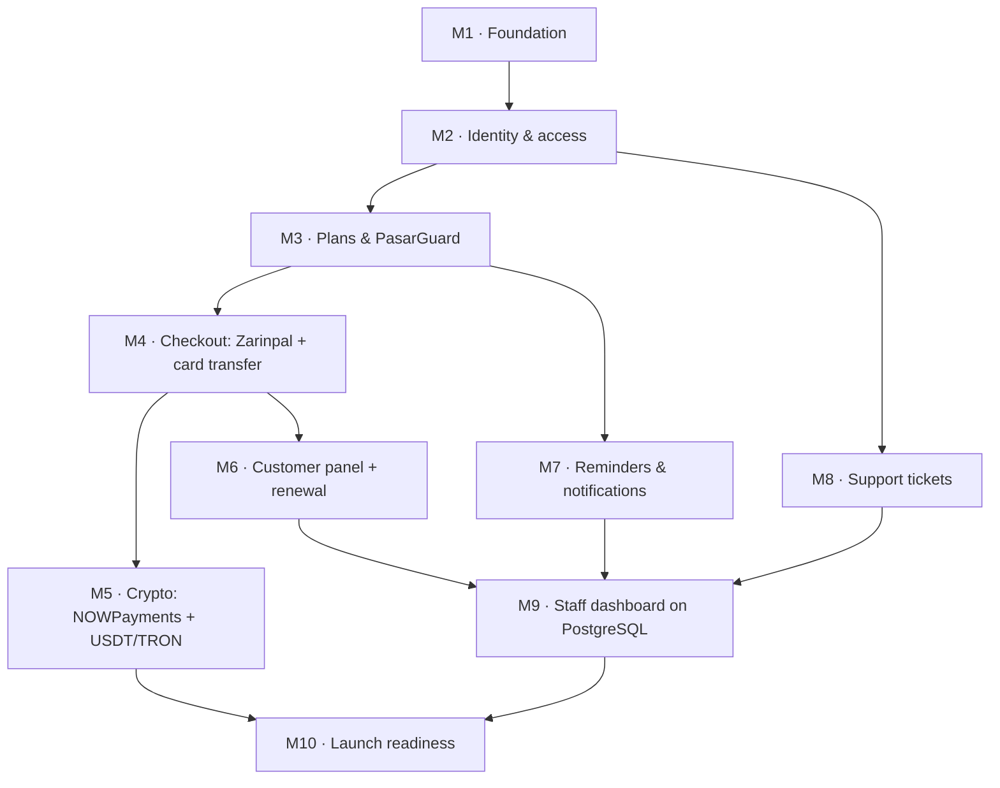

# مرحله‌ی ۳: نقشه‌ی راه

> وضعیت: **پیش‌نویس برای تأیید.** معماری در [مرحله‌ی ۱](01-architecture.md) و دیتابیس در [مرحله‌ی ۲](02-database.md) تأیید شده‌اند.

## خلاصه

- **فاز ۱ (MVP)** همان چیزی است که تعیین کردید: ثبت‌نام و ورود، تعریف پلن، پرداخت، اتصال خودکار به PasarGuard و تحویل فوری سرویس، پنل کاربری ساده، یادآوری انقضا و تیکتینگ. به‌علاوه‌ی کارهایی که بدون آن‌ها این موارد قابل عرضه نیستند (پایین‌تر، «سه افزوده به MVP»).
- فاز ۱ به **۱۰ نقطه‌ی تحویل** (milestone) تقسیم شده است. هر نقطه به‌تنهایی قابل اجرا و آزمودن است. **بعد از هر نقطه منتظر تأیید شما می‌مانم**، همان‌طور که برای مرحله‌ها خواستید.
- بقیه‌ی قابلیت‌ها در **۶ فاز بعدی**، به ترتیبی که بیشترین درآمد را زودتر می‌آورد. ترتیب فازهای بعد از MVP پیشنهاد من است و تصمیم آن با شما است.
- **تقویم نمی‌دهم، اندازه‌ی نسبی می‌دهم** (کوچک / متوسط / بزرگ). تخمین روز و هفته برای کاری در این اندازه قبل از شروع، حدس است و به‌جای برنامه‌ریزی، انتظار غلط می‌سازد.

## فاز ۱: MVP

### چه چیزی تحویل می‌شود

یک مشتری با ایمیل ثبت‌نام می‌کند، یک پلن حجمی-زمانی را با زرین‌پال، کارت‌به‌کارت یا ارز دیجیتال می‌خرد و **چند ثانیه بعد از پرداخت** لینک اشتراک و QR Code را می‌گیرد. در پنلش حجم و روزهای باقی‌مانده را می‌بیند، قبل از انقضا ایمیل یادآوری می‌گیرد، می‌تواند تمدید کند و تیکت ثبت کند. تیم داخلی پلن‌ها و سرورها را تعریف می‌کند، رسیدها و انتقال‌های ارز دیجیتال را بررسی می‌کند، تیکت‌ها را جواب می‌دهد و فروش را در داشبورد فعلی می‌بیند.

### سه افزوده به MVP (نیاز به تأیید شما)

این‌ها در فهرست MVP شما نبودند، ولی بدون آن‌ها فهرست قابل عرضه نیست:

| افزوده | چرا لازم است |
|---|---|
| **تمدید ساده** (خرید دوباره‌ی همان پلن برای همان سرویس) | یادآوری انقضا بدون امکان تمدید، مشتری را به خرید یک سرویس جدید با لینک جدید می‌فرستد و باید همه‌ی دستگاه‌هایش را دوباره تنظیم کند. تمدید ساده همان مسیر خرید است با یک اشتراک مقصد؛ ارتقا، افزودن حجم و تمدید خودکار در فاز ۲ می‌مانند. |
| **فارسی‌سازی و راست‌چین کل سایت** | زبان سایت فارسی است و رابط فعلی انگلیسی است. زیرساخت آن در اولین نقطه ساخته می‌شود تا هر صفحه‌ی جدید از اول فارسی ساخته شود، نه اینکه بعداً دوباره کار شود. |
| **صفحات قانونی ساده** (قوانین، حریم خصوصی، بازپرداخت) | درگاه‌های پرداخت معمولاً قبل از فعال کردن حساب، وجود این صفحات را بررسی می‌کنند. در MVP متن ثابت‌اند؛ مدیریتشان از داشبورد در فاز ۶ است. |

### ترتیب نقاط تحویل

`M5` (ارز دیجیتال) و `M6`–`M8` به هم وابسته نیستند و ترتیبشان قابل جابه‌جایی است. اگر فروش با زرین‌پال و کارت‌به‌کارت برای شروع کافی باشد، `M5` می‌تواند آخر بیاید.

### نقاط تحویل

#### M1 · زیرساخت — بزرگ
- ساختن مخزن git (پیش‌نیاز همه‌چیز)
- monorepo با pnpm: `back-end` به `apps/server` و `front-end` به `apps/web` منتقل می‌شوند؛ پکیج `packages/contracts` برای schemaهای zod مشترک
- TypeScript در سرور (تدریجی)؛ PostgreSQL با Drizzle و migration برای **۴۲ جدول MVP** از روی [`02-schema.sql`](02-schema.sql)
- Redis، BullMQ، صندوق خروجی (outbox) و relay آن؛ نقش‌های اجرایی `api` / `worker` / `scheduler`
- Docker Compose برای محیط توسعه (PostgreSQL + Redis)
- زیرساخت چندزبانی و راست‌چین در فرانت (i18next، `dir="rtl"`، فونت فارسی، کلاس‌های منطقی Tailwind)
- یک دستور برای lint + typecheck + همه‌ی تست‌ها
- **آزمون پذیرش:** `docker compose up` و `pnpm test` روی یک سیستم تمیز کار می‌کنند؛ یک رویداد outbox وقتی Redis خاموش است نوشته می‌شود و بعد از روشن شدن Redis به صف می‌رسد.

#### M2 · هویت و دسترسی — متوسط
- ثبت‌نام و ورود با ایمیل + رمز، **و** ورود با کد یک‌بارمصرف ایمیلی؛ تأیید ایمیل؛ بازیابی رمز
- session در Redis؛ محدودیت نرخ برای ورود و ارسال کد
- نقش‌ها و مجوزها؛ **ورود دومرحله‌ای اجباری برای کارمندان**؛ audit log
- اسکریپت ساخت حساب مالک (دیتابیس خالی شروع می‌شود)
- **آزمون پذیرش:** کارمند بدون ورود دومرحله‌ای به داشبورد راه ندارد؛ پنج تلاش ناموفق ورود، حساب را موقتاً قفل می‌کند؛ هر تغییر نقش در audit log ثبت می‌شود.

#### M3 · پلن‌ها و اتصال به PasarGuard — بزرگ
- تعریف پنل، لوکیشن و سرور از داشبورد؛ credential رمزنگاری‌شده
- تعریف پلن حجمی-زمانی با محدودیت دستگاه؛ نگاشت پلن به groupهای پنل
- `PanelDriver` و `PasarGuardDriver`: ساخت، خواندن، ویرایش، ریست، ابطال لینک، فعال/غیرفعال، حذف، فهرست
- **تست قرارداد روی پنل تستی شما** (کاربران تستی می‌سازد و بعد پاک می‌کند)
- لینک اشتراک روی دامنه‌ی ما (`/s/{token}`) و پراکسی آن به پنل
- job همگام‌سازی مصرف؛ انتخاب سرور برای مشتری جدید بر اساس ظرفیت و اولویت
- **آزمون پذیرش:** یک اشتراک از داشبورد ساخته می‌شود، روی پنل تستی ظاهر می‌شود، لینک ما در یک کلاینت واقعی v2ray باز می‌شود و حجم مصرفی در CRM دیده می‌شود.

#### M4 · خرید و پرداخت: زرین‌پال و کارت‌به‌کارت — بزرگ
- خرید حداکثر در سه قدم: انتخاب پلن ← روش پرداخت ← پرداخت
- سفارش با کلید idempotency؛ ثبت در دفتر مالی؛ فاکتور
- **زرین‌پال** (با آزمون زودهنگام درخواست از سرور خارجی؛ مرحله‌ی ۱ این را ریسک شناخته است)؛ استعلام دوره‌ای پرداخت‌های تأییدنشده
- **کارت‌به‌کارت:** آپلود رسید، صف بررسی حسابدار، علامت‌گذاری خودکار رسید تکراری و مبلغ نامطابق
- **تحویل خودکار:** outbox ← worker ← PasarGuard، با تلاش مجدد؛ هشدار به مدیر (ایمیل و تلگرام) بعد از چند شکست؛ دکمه‌ی «تلاش دوباره» در داشبورد
- صفحه‌ی موفقیت که بدون refresh، لینک و QR را به محض آماده شدن نشان می‌دهد
- **آزمون پذیرش:** از پرداخت در sandbox زرین‌پال تا نمایش QR کمتر از ۱۰ ثانیه؛ با پنل خاموش، پول ثبت می‌ماند، مدیر هشدار می‌گیرد و بعد از روشن شدن پنل سرویس خودکار ساخته می‌شود؛ callback تکراری سرویس دوم نمی‌سازد.

#### M5 · ارز دیجیتال: NOWPayments و USDT روی TRON — بزرگ
- job نرخ از `apiv2.nobitex.ir` و محافظ نرخ کهنه
- NOWPayments: فاکتور، بررسی امضای callback، خواندن دوباره‌ی وضعیت از API
- USDT مستقیم: نمایش آدرس و مبلغ دقیق، خواندن انتقال‌ها از بلاک‌چین، جور کردن با فاکتور، صف بررسی انتقال‌های جورنشده
- **آزمون پذیرش:** پرداخت روی testnet شبکه‌ی TRON (Nile) با مبلغ دقیق، سرویس را تحویل می‌دهد؛ مبلغ اشتباه در صف بررسی دیده می‌شود؛ توکن جعلی با نام USDT نادیده گرفته می‌شود؛ با قطع نرخ، گزینه‌ی ارز دیجیتال از صفحه‌ی خرید حذف می‌شود.

#### M6 · پنل کاربری و تمدید — متوسط
- سرویس‌های من: حجم باقی‌مانده، روزهای باقی‌مانده، وضعیت، لینک با دکمه‌ی کپی و QR
- تمدید ساده؛ تاریخچه‌ی پرداخت‌ها و فاکتورها؛ تنظیمات حساب
- صفحه‌ی خانه و قیمت‌ها برای پلن‌های حجمی-زمانی
- **آزمون پذیرش:** بعد از تمدید، لینک مشتری عوض نمی‌شود و فقط تاریخ و حجم به‌روز می‌شوند.

#### M7 · یادآوری و اعلان‌ها — متوسط
- قالب‌های ایمیل فارسی و قابل ویرایش از داشبورد
- یادآوری ۳ روز و ۱ روز مانده، مصرف ۸۰٪ و ۱۰۰٪؛ هر یادآوری فقط یک بار در هر دوره
- ایمیل «سرویس آماده است»، «پرداخت دریافت شد»، «پاسخ تیکت»
- **آزمون پذیرش:** با جلو بردن ساعت در تست، هر یادآوری دقیقاً یک بار ارسال می‌شود و بعد از تمدید دوباره فعال می‌شود.

#### M8 · تیکتینگ — متوسط
- ثبت تیکت با دسته و اولویت؛ گفت‌وگو و پیوست؛ یادداشت داخلی کارمند
- صف پشتیبانی (منتظر کارمند، فوری‌ترین اول)؛ ارجاع به کارشناس
- اطلاعات سرویس و تاریخچه‌ی مشتری کنار هر تیکت؛ اعلان تیکت جدید به کارشناسان
- **آزمون پذیرش:** مشتری یادداشت داخلی را نمی‌بیند؛ پاسخ کارمند وضعیت را به «منتظر مشتری» می‌برد و ایمیل می‌فرستد.

#### M9 · داشبورد کارمندان روی PostgreSQL — متوسط
- انتقال بخش‌های فعلی (فروش، مشتریان، محصولات که به پلن‌ها تبدیل می‌شود، کاربران، ژورنال) به PostgreSQL
- صفحه‌های جدید: سفارش‌ها و پرداخت‌ها، صف بررسی رسید و انتقال ارز دیجیتال، اشتراک‌ها با عملیات پایه (تلاش دوباره، غیرفعال/فعال، ریست حجم)
- فارسی‌سازی و راست‌چین داشبورد و صفحات قدیمی
- **آزمون پذیرش:** همه‌ی تست‌های فعلی داشبورد روی دیتابیس جدید سبزند.

#### M10 · آمادگی عرضه — متوسط
- Docker Compose برای production؛ Caddy با TLS خودکار؛ HTTPS اجباری
- پشتیبان‌گیری خودکار **و یک بار بازیابی واقعی از پشتیبان**
- مرور امنیتی کامل؛ آزمون بار با اندازه‌ی واقعی (۱۰٬۰۰۰ کاربر)
- راهنمای نصب و راه‌اندازی، و راهنمای عملیات (کار در قطعی پنل، درگاه یا نوبیتکس)
- کنار گذاشتن MongoDB و کد قدیمی
- **آزمون پذیرش:** نصب از صفر روی یک VPS خالی فقط با راهنما.

### تست‌های حیاتی در فاز ۱
مسیرهایی که نیازمندی‌ها صریحاً پوشش تست خواسته‌اند، روی **PostgreSQL واقعی** آزموده می‌شوند، نه روی شبیه‌ساز:
- **پرداخت:** هر روش، callback تکراری، پرداخت دیرهنگام، **دو خرید هم‌زمان با یک موجودی** (موردی که در مرحله‌ی ۲ با PGlite قابل آزمون نبود)
- **ساخت سرویس:** موفق، پنل خاموش، پاسخ گم‌شده (تلاش مجدد کاربر دوم نمی‌سازد)
- **تمدید:** تاریخ و حجم درست، بدون تغییر لینک

### بیرون از MVP (عمداً)
کیف پول و تمدید خودکار، کد تخفیف، تست رایگان، ارتقا و افزودن حجم، ربات تلگرام، نمایندگی و افیلیت، کمپین و پیام گروهی، مانیتورینگ سرور و صفحه‌ی وضعیت، هزینه و سود سرور، جابه‌جایی گروهی، آموزش‌ها و سؤالات متداول قابل مدیریت، سئو با SSR، شاخص‌های MRR / churn / LTV، تشخیص تقلب، خروجی Excel، ورود دومرحله‌ای مشتری، زبان انگلیسی، پنل‌های دیگر VPN.

## فازهای بعد از MVP

ترتیب پیشنهادی: **اول هر چیزی که درآمد تکرارشونده را نگه می‌دارد، بعد کانال‌های فروش، بعد عملیات، بعد رشد.**

| فاز | محتوا | چرا در این جایگاه | اندازه |
|---|---|---|---|
| **۲ · نگه داشتن درآمد** | کیف پول و شارژ آن، تمدید خودکار از کیف پول، تمدید و ارتقا با یک کلیک، افزودن حجم یا روز، کد تخفیف، تست رایگان با جلوگیری از سوءاستفاده، نمودار مصرف، ورود دومرحله‌ای مشتری | هر مشتری‌ای که تمدید نکند باید دوباره جذب شود؛ این فاز همان مشتری را نگه می‌دارد | بزرگ |
| **۳ · ربات تلگرام** | ثبت‌نام، خرید، پرداخت، دریافت کانفیگ، وضعیت سرویس، تمدید و تیکت؛ کلاینت همان API | در بازار VPN ایران بخش بزرگی از فروش از تلگرام است؛ همه‌ی منطقش تا اینجا ساخته شده | متوسط |
| **۴ · همکاری در فروش** | پنل نماینده، قیمت عمده، اعتبار نماینده، چندسطحی، معرفی و افیلیت، پورسانت و برداشت | به کیف پول و دفتر مالی فاز ۲ تکیه دارد | بزرگ |
| **۵ · عملیات و زیرساخت** | مانیتورینگ و هشدار سرور، صفحه‌ی وضعیت، هزینه و سود هر سرور و پلن، جابه‌جایی گروهی، پاسخ‌های آماده | با بزرگ شدن تعداد سرورها ارزشمند می‌شود | متوسط |
| **۶ · رشد و محتوا** | SSR و سئو، sitemap و داده‌ی ساختاریافته، آموزش هر سیستم‌عامل، FAQ، صفحات فرود و قانونی قابل مدیریت، نظرات مشتریان، سگمنت، کمپین، اتوماسیون بازگرداندن مشتری | وقتی فروش پایدار است، جذب را بیشتر می‌کند | بزرگ |
| **۷ · تحلیل و امنیت پیشرفته** | MRR، churn، LTV، نرخ تبدیل تست و نرخ تمدید، عملکرد نماینده‌ها، خروجی گزارش، تشخیص تقلب، مدیریت نقش‌ها از داشبورد | به داده‌ی چند ماه فروش واقعی نیاز دارد تا معنا داشته باشد | متوسط |
| **هر وقت لازم شد** | پنل‌های دیگر (Marzban، 3x-ui، Hiddify)، زبان انگلیسی، پیامک | معماری از اول برایشان جا گذاشته؛ اضافه کردنشان به تغییر هسته نیاز ندارد | کوچک تا متوسط |

## نحوه‌ی کار در هر نقطه‌ی تحویل

1. پیاده‌سازی با تست
2. اجرای lint، typecheck و همه‌ی تست‌ها؛ نتیجه‌ی واقعی گزارش می‌شود، نه «باید کار کند»
3. به‌روزرسانی راهنمای نصب و اجرا
4. گزارش کوتاه: چه ساخته شد، چه آزموده شد، چه چیزی آزموده نشد و چرا
5. **منتظر تأیید شما، بعد نقطه‌ی بعد**

## آنچه از شما لازم دارم

| مورد | برای | کی لازم است |
|---|---|---|
| **نصب Docker Desktop** روی همین سیستم | PostgreSQL و Redis محلی. الان روی سیستم نصب نیست. | قبل از M1 |
| اجازه‌ی ساخت مخزن git | اولین کار M1 | قبل از M1 |
| فهرست پلن‌ها (حجم، مدت، قیمت به تومان، تعداد دستگاه) | ساخت پلن‌های اولیه | M3 |
| merchant ID زرین‌پال (sandbox برای شروع، واقعی برای آزمون سرور خارجی) | پرداخت آنلاین | M4 |
| شماره‌ی کارت‌های مقصد کارت‌به‌کارت | نمایش به مشتری | M4 |
| یک ربات تلگرام و شناسه‌ی گروه مدیران | هشدار شکست تحویل سرویس | M4 |
| سرویس ارسال ایمیل (SMTP) برای production | ایمیل‌ها به Inbox برسند، نه Spam | M7 |
| حساب NOWPayments (API key و IPN secret) | پرداخت با NOWPayments | M5 |
| آدرس کیف پول TRON (**فقط آدرس عمومی، نه کلید خصوصی**) و یک کلید رایگان TronGrid | دریافت مستقیم USDT | M5 |
| سرور production خارج از ایران و دامنه‌ها | استقرار | M10 |
